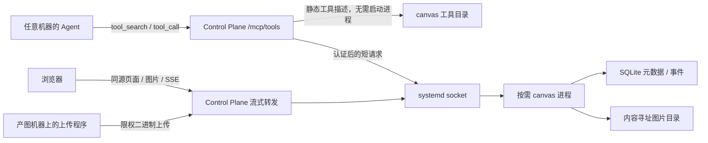

# 设计：Agent 实时画布工具

状态：待评审（2026-11-12）。本轮只提交设计；尚未实现、注册工具、迁移资源或部署服务。下面的接口、路径和配置名均为提案。

代码核对基线：agent-bridge `bb0a93b`（根版本 `0.7.85`），以及已归档的 kindergarten-menu / imaginarium 的 `dashboard/canvas.py`、`canvas_page.py`、`server.py`、`data.py`。归档只读，旧工作台不重新启用。

约束依据：[AGENTS.md](../AGENTS.md)、[技能库设计](agent-skills-design.zh.md)、[中央工具库](tool-hub-design.zh.md)、[控制面架构](v0.7-server-architecture.zh.md)、[审批与权限](approval-permissions.zh.md)。技能库文档开头明确取消的 Bridge 技能同步阶段优先于正文保留的历史规划。

## 1. 推荐结论与评审项

**把 canvas 做成中央工具库的内置能力，以一个按需启动的小进程承载图片、状态和网页。** Agent 使用现有 `/mcp/tools`；浏览器通过普通 HTTPS 页面、图片请求和 SSE 看更新。MCP 是调用入口，不负责向浏览器分发图片，也不要求 Agent 持有长连接。

| 决策 | 推荐 | 需要评审的取舍 |
| --- | --- | --- |
| 运行位置 | Control Plane 内置工具描述与薄适配器；canvas 运行进程采用 socket activation + idle-exit | 多一个受 systemd 管理的运行单元，换取空闲时没有新增应用进程、不把大图处理放进控制面 |
| 图片归属 | 默认托管快照；文件按内容哈希存储，SQLite 只存元数据 | 服务需要磁盘配额，但页面不依赖原工作台、调用机器在线或临时图床 URL |
| 保留与删除 | 默认保留，关闭画布只结束展示任务；清理先预览、后按明确授权执行 | 不自动腾空间；达到配额时拒绝新写入，不静默淘汰 |
| 浏览器入口 | 复用部署配置指定的内网/VPN HTTPS 入口，使用 `/canvas/` 路径 | 默认不申请新域名、不开放新 TCP 端口；实际域名及访问范围在部署前确认 |
| 跨 Agent 使用 | 所有 Agent 均能发现并创建画布；已有画布按调用身份授权 | “工具可发现”不等于“所有画布可读写”；第一版以同一 agent principal 下的会话协作为主 |

第一版只提供图片展示、追加与任务状态。保留全屏、淡入切换、缩略图、键盘导航和幻灯片；去掉旧页面的生成面板。生成由调用 Agent 和现有 AIGC 工具完成，canvas 不连接模型、ComfyUI 或 i2v 流水线。视频、任意 HTML、通用文件网盘、多用户编辑器均不进入第一版。

## 2. 已核实的现状

| 现有实现 | 可以复用的部分 | 需要重新定义的部分 |
| --- | --- | --- |
| `CanvasService` | 创建、列举、查询、追加、发布事件的职责边界很小 | 启动时读入所有 JSON；每次追加重写整张画布；文件写入不在完整事务内，并发持久化可能覆盖较新的状态 |
| 外部图片追加 | 接受外部产出，不必由画布生成 | 默认保存远端 URL；本地路径和落盘图片经 `path_to_file_url` 变成旧 `/api/files?path=...`；base64/下载会把图片整体放进内存 |
| SSE | 浏览器能立即收到 `image_added` | 队列只在内存中、无界，没有持久事件编号；检查画布和订阅之间也有竞态 |
| 幻灯片页面 | 原生 HTML/CSS/DOM 已满足轻量展示 | 先取全量再连接会漏事件；重连全量读取；每张原图都创建舞台及缩略图元素，长画布会加载大量图片 |
| 工作台 server | 路由形状可作迁移参考 | 初始化依赖完整生成服务；不能直接拿来运行；不保留 `/generate` 和旧文件代理 |

Bridge 里已有可利用的机制，也有不能直接套用的地方：

- `apps/control-plane/src/mcp/tools.ts` 已认证调用方，并把 `principal.id` 传给 `ToolHub.call`。`tools.ts` 已支持内置工具的静态描述、置顶和发现。
- 普通上游 MCP 的工具清单缓存 10 分钟；目录刷新会连接上游。直接把 canvas 登记成远端 MCP，会让一次无关的工具搜索也可能启动它。内置静态描述可避免这一点。
- 当前 `web` / `decide` 内置分支在通用风险判断前直接执行。canvas 必须接入风险判断，不能照搬这个快捷路径，尤其不能据此声称删除会被登记表自动拦住。
- 控制面已有按 SHA-256 寻址的附件，但字节在控制面 SQLite 中，上传使用 base64，清理按 `created_at`，默认 7 天且不检查画布引用。不能把附件 ID 直接当作画布的永久资源引用。附件格式文档有历史描述，本结论以 `api/validation.ts`、`api/router.ts`、`packages/database/src/control.ts` 为准。
- 控制面承担 Bridge WebSocket 和调度，原本就常驻。不会为了 canvas 把整个控制面改成 idle-exit。

## 3. 独立服务与内置工具的边界

| 方案 | 成本与效果 | 结论 |
| --- | --- | --- |
| 恢复旧工作台，外包一层 MCP | 带回已归档的生成依赖、旧文件路径及生命周期问题 | 不采用 |
| 独立 canvas 产品，单独 MCP 配置、域名和权限 | 可以独立运行，但每个客户端需要接入；中央认证与发现已有对应能力 | 当前没有必要 |
| 全部嵌入 Control Plane | 代码接入最少，复用 HTTP 入口；磁盘故障、图片解码及资源管理与控制面共用进程 | 可行备选；不作为满足低频服务 idle-exit 的首选 |
| **内置工具 + 按需 canvas 进程** | 复用认证、发现与入口；运行进程独立管理文件、SQLite 和 SSE | **推荐** |

这里的“内置”指 Agent 所见的工具入口与仓库中的通用能力，不表示所有字节都必须由控制面业务代码处理。第一版不新增公开的 `/mcp/canvas`，也不部署每会话一个 stdio 服务。



运行进程使用 TypeScript、Node 和现有 Hono/HTTP 组织方式，复用仓库的校验、SSE 背压思路；不引入 Python 工作台依赖。旧页面的纯展示部分可小范围移植，存储层用事务和增量记录替换。无需抽象出通用对象存储平台。

## 4. 资源存储与跨机器取图

### 4.1 所有权与数据布局

托管资源由 canvas 管理，原文件仍归产图项目所有。读取源文件后不移动、不删除源文件，也不依赖源目录的硬链接或符号链接。状态放在部署指定的本地磁盘，不能放 Git checkout 或默认依赖网络挂载。

建议数据根为 `CANVAS_DATA_DIR`，部署示例 `/var/lib/agent-canvas`：

```text
CANVAS_DATA_DIR/
  canvas.sqlite                  # 元数据、持久事件、幂等回执、上传/访问授权
  objects/sha256/<前两位>/<hash>   # 原始图片，一份内容一份文件
  previews/<版本>/<hash>.webp     # 小预览；按需生成，可重建
  staging/<upload-id>.part        # 有大小上限的上传/导入暂存
```

SQLite 使用 WAL 和短事务，字节不进入数据库。主要记录是 `canvases`、`images`、`assets`、`events`、`uploads`、`access_grants`、`idempotency`。画布持有单调递增的 `seq`；图片有稳定 `image_id`、`asset_id`、加入时的序号及有限大小的说明。`owner` 来自已认证的调用上下文，`source_session_id` 仅作来源标记，不是权限凭据。

资源哈希负责完整性与去重，不是读取权限。每次读取都检查该资源确实属于获准访问的画布。已有哈希只有调用方已被授权复用时才可直接关联；不能凭猜中哈希获取别人的文件。

### 4.2 三种输入

| 输入 | 行为 | 生命周期 |
| --- | --- | --- |
| 调用机器上的文件 | 在产图机器计算 SHA-256 和大小；取得上传授权后以 HTTP PUT 流式上传；随后追加返回的 `asset_id` | 与调用机器断开、会话结束无关 |
| 远端 HTTP(S) URL，默认 `managed` | 服务端抓取一次、校验、存成托管对象；返回稳定的 canvas 资源地址 | 源 URL 失效后仍可访问 |
| 远端 URL，显式 `reference` | 只保存引用，浏览器直接取源站图片，不代理、预取或偷偷转成托管副本 | 由源站负责；源站失效时显示资源不可用 |

MCP 参数不接受 `C:\...`、`/home/...` 等任意路径来替别的机器读文件，也不传图片 base64。当前 MCP 请求体上限为 1 MiB，模型上下文也不适合搬图片。上传程序从获准的运行配置/工具结果中读取短期授权，通过请求头发送，不把凭据放命令参数或日志。

托管导入只接受图片白名单（建议首期 PNG/JPEG/WebP/GIF），验证实际格式、像素与字节上限，拒绝 HTML/SVG 等主动内容。建议单图上限 48 MiB，具体值随配额一起评审。远端抓取有超时、流量上限，并逐跳检查重定向与实际目标地址；默认允许公网 HTTPS，内网图源以部署级 origin/地址许可列表开启，禁止访问元数据、管理端口和 canvas 自身接口。不能只检查 URL 字符串而忽略 DNS 结果；不转发 Agent 的认证头。

带签名参数的源 URL 只在本次导入期间使用；持久来源说明、审批记录及日志去掉凭据和签名查询参数，幂等记录保存参数指纹，不保存原始签名 URL。`reference` 模式需保存可重用地址，因此只推荐无需私密请求头、无需长期保存临时凭据的来源；它也会让浏览器联系该源，工具结果应明确标为外部引用。

现有 Bridge 附件若以后需要导入，应通过受认证附件 API **一次性复制为 canvas 自己的对象**，成功后不再依赖附件 TTL；不共享控制面数据库或通过延长全局附件保留期解决。这个便利入口不是首期必需功能。

### 4.3 上传、幂等与提交

1. `prepare_upload` 提交目标画布、哈希、大小及 MIME。若已有获准复用的对象，直接返回 `asset_id`，不上传字节；否则持久化短期上传授权和容量预留。
2. 调用机器对授权地址 PUT 原始字节。授权限制画布、哈希、大小及有效期，只能写这个上传对象；建议 10 分钟有效。上传完成时重新计算哈希、验证格式，原子安装对象后标记 ready。
3. `add_image` 使用 `asset_id` 和幂等键，在一个事务里写图片引用、事件、`seq` 与回执；事务提交后才通知 SSE。结果只返回新增条目与当前游标，不返回整张画布。
4. 回包丢失时先查 `upload_status` 或重试相同幂等键；已完成上传不重传，已提交追加不重复增加一张图。首期不做分块续传，确实未完成的单个上传可以重传受限大小的文件。

上传授权在成功校验时消费；重复 PUT 不覆盖已完成对象。幂等回执只存资源/授权记录 ID，不存明文凭据；短期凭据由固定授权字段和部署签名密钥生成，重试可重建同一份有效授权。授权过期后需重新申请，已完成的资源仍可按身份查询。

URL 导入同样先占用幂等记录及配额，再开始下载；已有成功回执直接返回。相同键不同参数返回冲突。下载在事务外，持有活动引用，受单次超时限制；不引入后台生成队列或由断开的 MCP 会话托管长任务。

文件安装先于图片事务提交；失败可能留下未引用对象，但不能留下指向半张图片的已提交记录。暂存、ready、attached、failed 的恢复信息落库，启动时只查未完成记录，不遍历全部图片。对象安装、目录持久化与数据库提交的崩溃窗口需验收；孤儿对象进入清理预览，不擅自删除。

### 4.4 页面如何取图

工具返回画布链接和资源 ID，不返回服务器物理路径。托管图片使用同源 `/canvas/{id}/assets/{asset_id}`，脱离旧 `/api/files`；外部引用则保留其显式外链语义。

图片响应提供正确 MIME、长度、`nosniff` 和基于哈希的 ETag；默认 `Cache-Control: private, no-cache`，重验证先检查授权，未变化返回 304。静态 JS/CSS 可用文件哈希长缓存。状态元数据单独用 revision/ETag，不因为重读一条状态去重新下载图片。

页面只装入当前图片和相邻预取图片；缩略图分页、懒加载。预览由有并发/像素上限的转换任务按需生成一次，原图不反复转码；动画原图仍可播放。长画布不在初次访问时下载全部原图。

## 5. MCP、HTTP 与调用身份

### 5.1 拟议工具契约

所有变更工具接受 `idempotency_key`，返回结构化小结果。分页上限和元数据长度由 schema 明确约束。常见错误有 `not_found`、`forbidden`、`conflict`、`quota_exceeded`、`source_unavailable`、`cursor_invalid`，调用方不必靠解析大段自然语言恢复。

| 工具 | 主要输入/输出 | 建议档位与首期范围 |
| --- | --- | --- |
| `canvas.create` | 标题 → `canvas_id`、`view_url`、游标、实际保留策略 | auto；默认 `keep` |
| `canvas.list` / `canvas.get` | 分页摘要、指定画布的状态/图片页或 `after_seq` 增量 | auto；只读自己获准访问的画布 |
| `canvas.prepare_upload` / `canvas.upload_status` | 文件描述 → 上传授权或已有 `asset_id`；上传恢复查询 | auto；限制配额 |
| `canvas.add_image` | `asset_id` 或 URL，`managed/reference`，标题/说明 → 单条图片及游标 | auto；服务端校验来源与大小 |
| `canvas.set_status` | `working/complete/failed`、有限长度说明 | auto；展示生成过程，自己不执行生成 |
| `canvas.close` | 结束实时展示任务，冻结追加，保留网页和图片 | auto；可通过 `set_status(working)` 显式重新打开 |
| `canvas.view_link` | 取得/轮换一个限于此画布、带过期时间的只读链接 | auto；不自动发送到房间或第三方 |
| `canvas.cleanup_plan` | 范围 → 候选画布/资源数、字节数、受影响引用、计划哈希 | auto；只读预览，不清理 |

第一版不开放 `delete` / `cleanup_apply`。评审清理规则后再加入 human 档的执行入口，不能用模型传入 `confirmed=true` 代替人的授权。容量不足不会触发隐式删除。

`complete/failed` 只改变展示状态，不冻结追加；`close` 单独设置关闭标记，页面收到关闭事件后停止实时连接，显示最后状态。关闭页面不关闭画布，Agent 会话结束也不删除画布。

典型使用顺序是：Agent 创建画布并把链接交给用户；调用既有生成工具，每产出一张图就上传/导入并追加，期间更新状态；完成后写入结果状态并关闭画布。不会为了画布另开一个 Agent 或让浏览器直接启动生成任务。

### 5.2 接入中央工具库

- 在 Control Plane 内定义 `CANVAS_TOOLS` 静态描述和 `canvas` 调用适配器；私有工具登记表使用 `transport.builtin: canvas`。这里描述的是**需实现的分支**，当前只加登记表不会使它工作。
- 静态工具发现不访问 socket、不启动 canvas、不读取图片目录；调用时才启动后端。所有 Agent 继续使用已经安装的 `/mcp/tools`，不另改各机器 MCP 配置。
- 复用 `riskOf`、审核/人工决策与记录机制，把 canvas 分发放到决策之后；不能在 `web` / `decide` 旁加入无条件提前返回。风险档表是待确认提案，本轮不改审批规则。
- 工具库的 `pinned` 仅决定开局提示，和画布保留/权限无关。默认只在需要的作用域置顶，其他作用域可搜索；不硬编码私人作用域或房间 ID。
- 当前上游 MCP 转发只带工具参数、不转发已认证 `caller`；因此不能把 `owner` 放在可由 Agent 自填的参数里充当身份。内置适配器从 `ToolHub.call` 的上下文传递真实 principal。

Control Plane 与 canvas 的内部调用走受文件权限保护的 Unix socket，并用部署凭据认证内部管理路由；调用者身份只由适配器附加，不接受外部同名 header 覆盖。canvas 只需要信任控制面的内部身份，不读取全量 `AGENT_TOKENS`。

### 5.3 浏览器与上传入口

| 外部路径 | 用途与认证 |
| --- | --- |
| `/canvas/{id}/` | 只读页面壳，不在 HTML 中内嵌未认证的画布数据 |
| `/canvas/{id}/access` | 将链接中的限权凭据交换成此画布的浏览器 cookie |
| `/canvas/{id}/state`、`/images`、`/events` | 状态、图片分页、浏览器 SSE；要求只读 cookie |
| `/canvas/{id}/assets/{asset_id}` | 同源图片/预览；检查 cookie 与画布引用 |
| `/canvas-uploads/{upload_id}` | PUT 原始图片；要求专用上传授权，不接受只读 cookie |
| `/canvas-static/*` | 受限目录内的版本化网页静态资源 |

只读链接采用 `.../canvas/{id}/#access=<短期凭据>`：fragment 不送到服务器访问日志。页面把它通过同源 POST 换成 `HttpOnly; Secure; SameSite=Strict` cookie（限定此画布路径），随后清除 fragment。授权有随机不可猜 ID、有效期及服务端撤销状态；数据库只保存凭据摘要。建议链接默认有效 7 天，独立于图片的保留时间。过期后所有新资源请求需重新授权，已有下载副本不属于远端可撤回的数据。

页面、授权交换与 SSE 使用 `no-store`/适当流式缓存头、`Referrer-Policy: no-referrer`，内容不使用第三方脚本。浏览器取得的只有此画布的只读权限，永远得不到 Agent token 或内部服务凭据。上传授权只允许写入指定对象，不能读取画布。

Control Plane 仅转发上述白名单路径，清除伪造的内部身份头；浏览器转发分支**不附加内部管理凭据**。请求体、图片响应和 SSE 必须流式转发，传播取消、背压和断开，不能经过统一 JSON body parser 或响应聚合。内部路由不可从公开路径拼接到达。代理失败返回可重试错误，不缓存认证失败。

首期授权以稳定的 agent principal 为单位，不能把它描述成严格的会话隔离；当前工具上下文未提供可信会话身份。不同 principal 的共同编辑后续可增加明确授权的成员表；首期拿到只读链接不获得 MCP 写权限。

## 6. SSE：游标、恢复与少量传输

业务 SSE 和 MCP 的 Streamable HTTP 是两条独立连接。`add_image` 提交成功即可结束工具调用；浏览器保持 `/canvas/{id}/events`，不依赖 Agent 的调用持续在线。

每个可见变化在同一个 SQLite 事务里增加画布 `seq` 并写 `events`。事件只含图片描述/资源 ID、状态变化等小数据，不含图片字节。游标包含存储 epoch、画布 ID 和序号；正常重启保持 epoch，恢复到较旧备份时必须换 epoch，避免同一个序号代表两种历史。

正常打开与恢复顺序：

1. 页面读取状态和首张图片页，在同一个读事务取得高水位 `S`。图片记录首期只追加，后续分页限定 `added_seq <= S`，不为整次分页持有长期事务。
2. 建立 SSE，使用 `Last-Event-ID`，或初次连接时传 `after=<S>`。从数据库按索引读取 `seq > S`，分批发送带 `id:` 的事件；新追加不会掉在“快照与订阅之间”。
3. 订阅通知先安装，再读取高水位/补历史；补齐后再检查一次最新序号。通知只是唤醒信号，数据以数据库为准，避免从补历史切换到实时监听时漏事件。
4. 浏览器只在事件成功应用后更新游标。重连使用最后成功游标；服务端返回缺失区间，客户端按 `image_id`/序号处理重复投递，但服务端不全量重发来依赖这种去重。
5. 没有变化时只发小心跳，不重读整张画布。前台连接指数退避重连；页面隐藏即断开，恢复可见时用原游标补齐，不建立“轮询全量 + SSE”两套常驻恢复机制。

首期事件跟随画布保留，不另设较短事件 TTL，因此普通断线和进程重启不需要重置。未知 epoch、非法/超前游标或未来压缩后的过旧游标，先给 `resync_required` 和当前 revision；客户端对照分页的 `image_id + revision/hash` 清单，只获取变化/缺失的记录。新浏览器没有本地状态时才需要初始分页快照；图片仍按需加载。需要捕获游标错误的页面采用 fetch SSE 解析响应码和事件，不能让原生 EventSource 遇到永久错误后无限重连。

服务端按画布共享一次事件序列化和通知，单订阅者不积压无界队列。`write()` 背压时暂停发送，超过有界缓冲/时间预算就断开该慢客户端；重连从持久游标继续。SSE 心跳不落库、不增加 seq。浏览器仅保留最近状态和游标；需在整页刷新后继续复用历史时，客户端缓存清单与游标必须成对提交，否则重新取得初始页。

## 7. 生命周期、配额与清理

| 对象/状态 | 默认规则 |
| --- | --- |
| 画布 | `keep`；创建时返回实际保留规则；与 MCP session、Agent turn、进程寿命解耦 |
| 已关闭画布 | 可浏览、无实时 SSE；显式重新打开后才继续追加 |
| 托管图片 | 只要存在保留中的画布引用就保留；内容去重不改变所有权 |
| 外部引用 | canvas 只负责记录，不保证源站有效期，也不删除源站文件 |
| 上传/导入中间物 | 有限额及过期标记；过期禁止继续使用，清理策略未获批前只列入预览 |
| 浏览器凭据 | 到期停止授权，不连带删除画布或图片 |

建议部署先设单图、单画布、总对象存储三层限额，并限制并发导入/解码。可供评审的初值：48 MiB/图、500 张或 5 GiB/画布、50 GiB 总托管空间；实际磁盘容量未在本轮调查，这些不是已经分配的容量。画布按引用字节计费，总容量按实际对象加暂存/预览计费。上传前在短事务预留容量，防止并发绕过限额；失败、过期授权释放预留，但未删除的暂存仍计入实际占用。

元数据同样需要总配额和每次调用的长度/速率限制，不能只限制图片文件。相同状态不重复落事件，进度更新建议最多每秒一次；事件量到限额时拒绝新增并给出明确原因，不靠截掉历史保持可写。上传、下载及图片响应需有停滞超时，避免一个不再传数据的连接一直持有活动引用。

清理分两层，不能把“结束任务”解释成删除授权：

- **默认手工计划**：从数据库索引生成限定范围的清理清单，包括画布、引用、独占/共享对象和字节数。人批准具体计划后才执行；执行前重验版本与引用，计划过时则重新预览。删除共享对象前必须确认没有其他画布、待提交上传或进行中的读取持有它。
- **可选期限策略**：如果用户明确批准临时画布 TTL、宽限期和暂存清理边界，保存带范围/版本的策略，创建时选用该策略 ID。到期只是满足清理条件；按已批准规则分批执行。尚未批准时策略不能启用，Agent 不能自行用任意 `ttl=1` 取得删除许可。

后台不常驻扫描文件树。清理按 `expires_at`、引用关系和已记录失败状态索引，在下次请求唤醒时做有时间/条数预算的小批处理；需要严格在某个时刻释放空间时，另评审一次性 systemd timer，其唤醒也必须有已批准的清理范围。恢复排障需要的磁盘对账是显式维护操作。

对象删除要处理“检查无引用后又被追加”的竞态：先在事务中标记待删除、阻止新关联，再删除文件和完成记录；中断可重入，不能只读一遍引用数就 unlink。首期没有这个执行器；文档定义边界供后续实现。

备份时用 SQLite 在线备份机制把元数据复制到仓库外，再按备份里的对象清单增量复制不可变图片；备份期间持有清理屏障。预览可重建，不必备份。恢复先校验所引用的对象，再启用新 epoch，不扫描/重传所有产图项目。

## 8. 启动、空闲与并发

参考已只读核对的 go-hikaru `apps/server/src/main.ts`、`idle.ts`：接管 systemd fd 3，活动期间 hold，最后释放后空闲退出。新增单元提案为 `agent-canvas.socket` / `agent-canvas.service`。

- socket 使用 `Accept=no`，建议监听 `/run/agent-canvas.sock`，以部署配置的用户/组及 `0660` 权限允许 Control Plane 连接。服务接管 `LISTEN_FDS=1` 且 `LISTEN_PID` 匹配的 fd；不自行开启第二个 TCP 监听。socket 的寿命不随服务退出，不能把它放进随服务退出删除的 RuntimeDirectory。
- 只启用 socket 单元；service 正常退出码 0，`Restart=on-failure`，不使用 `Restart=always`。启动打开数据库与索引即可，不读入所有画布或原图。
- 活动 HTTP 请求、SSE、图片传输、上传/导入、预览转换及已开始的小批维护各持有引用；响应完成、断开或取消必须幂等释放。尚未开始的上传授权、尚未完成的外部生成任务、画布的 `working` 状态均不持有进程。
- 最后一个活动引用释放后建议 60 秒退出。空闲、心跳、超时等 Node timer 全部 `unref()`；不会把 `unref` 当作 HTTP listener 自动退出机制。退出时停止接收、关空闲 keep-alive、完成短事务、关闭 SQLite 和本进程 listener；systemd 保留监听 socket。
- 空闲退出和新连接竞态必须测试。转发器重建失效连接，GET 可重试；变更仅在已有幂等键时重试。上传若回包丢失先查状态，不能无条件重传整张图。
- 页面可见且保持 SSE 时，服务有实际活动，不能同时承诺“进程零占用”。关闭/隐藏最后一个页面且没有传输后退出；页面恢复触发重新启动并从游标补齐。已关闭画布默认不持有 SSE，再打开页面时检查最新状态。
- 推荐单进程、单数据库写入方，不引入多副本协调。文件传输流式处理；下载/解码并发分别限流。事务只覆盖元数据与事件；网络等待和图片转换不占写锁。追加事件按提交顺序编号，幂等键设唯一约束。

“无请求零占用”在这里指无新增 canvas 应用进程/定时任务；systemd socket、已有 Control Plane 和磁盘数据仍存在。不配置定时 HTTP 探活去反复唤醒它；监测由 socket/service 状态与真实请求指标完成。

正常部署不新增 `0.0.0.0` 端口，浏览器和远端产图机器访问既有 HTTPS 入口。若以后需要独立内网域名或直接 LAN 监听，再评审监听地址、TLS 和访问范围；开发调试允许显式配置 host/port。若现有控制面域名公网可达，必须在入口为 canvas 路径明确配置内网/VPN访问限制，不能把“同源”误当成“内网”。

## 9. 仓库布局与技能归属

推荐实现布局（本轮不创建这些实现文件）：

```text
docs/canvas-design.zh.md                 # 本设计与后续决策
apps/control-plane/src/canvas-tools.ts   # 工具 schema、调用身份、内部客户端
apps/control-plane/src/web/canvas.ts     # 白名单流式转发
apps/canvas/
  package.json / tsconfig.json
  src/main.ts / app.ts / idle.ts         # fd、路由、活动引用
  src/store.ts / assets.ts / events.ts   # SQLite、资源接收、游标
  web/index.html / canvas.ts / style.css # 旧幻灯片的纯展示部分
deploy/systemd/agent-canvas.socket
deploy/systemd/agent-canvas.service
tests/canvas-*.test.ts                   # 持久化/恢复/权限/空闲等行为验证
```

`tools.ts`、控制面路由装配、构建引用及部署脚本也需要小范围接线。网页随 canvas 包构建；不扩张 Control Center 或 DSH 插件，不引入新前端框架。

通用机制与设计进入公开 agent-bridge；实际域名、存储容量、内部图源许可列表、作用域置顶和工具登记留在私有部署配置/agent-skills 工具登记表，凭据由现有秘密配置提供。公仓示例只写占位符。

**工具先注册，技能不是运行条件。** 本文是项目设计，按 `agent-skills-design.zh.md` 放进 `docs/`；不写历史 `shared-skills/`。若之后需要跨项目的“创建画布 → 调 AIGC → 推图 → 收尾”操作手册，可经 Control Plane 的 `skill_write` 写入私有库 `scopes/<scope>/<category>/<skill>/SKILL.md`，不直接编辑其 checkout，也不把本设计重复包装成技能。技能可引用工具名和这份项目文档；不要求 Bridge 重启旧的技能同步阶段。

私有工具登记表涉及权限面，应按工具库既定提案/确认流程单独提交具体条目；本设计的风险档是评审材料，本轮没有注册或改变任何权限。

## 10. 评审通过后的实施与验收

建议先完成同一最小闭环：工具发现 → 创建 → 文件上传/URL 导入 → 追加 → 浏览器增量展示 → 退出与唤醒。既有归档数据不自动迁移；如要迁移，先单独列出获准画布及其源文件，旧 `/api/files` 地址解析成托管资源，仅复制获准对象，不改归档。

| 验收场景 | 通过条件 |
| --- | --- |
| 冷启动与发现 | 反复搜索工具不启动 canvas；首次真实调用由 socket 拉起；没有全目录读入 |
| Windows/WSL/其他机器产图 | 各自文件经流式上传显示；服务端不猜远端路径；相同已授权哈希第二次传 0 图片字节 |
| 临时 URL | 托管成功后令源站不可用，画布仍能显示；显式 reference 则显示源失效状态 |
| 幂等与并发 | 同键重试只追加一次；相同键不同内容冲突；并发写无覆盖、序号严格递增；配额预留不能被并发绕过 |
| 上传/提交崩溃 | 上传完成回包丢失能查询恢复；安装对象/提交事件中断后无可见半图；遗留项可预览 |
| 断线差量 | 已有 1000 条历史、断线新增 3 条，恢复只传这 3 条事件，不重拉 1000 条；首期 500 张建议限额下可用状态事件构造该历史 |
| 快照/订阅竞态 | 在初始分页、连接、补历史切换时追加均不丢失；慢消费者断开后仍可恢复 |
| 权限 | 猜到 ID/哈希不能跨画布读；只读链接不能写；浏览器头不能伪造内部 caller；上传授权不能超范围使用 |
| 空闲与 SSE | 可见页面/上传期间保持运行；全部断开后约 60 秒进程消失；下一请求恢复；状态 working 和过期授权不阻止退出 |
| 大图与长画布 | 传输内存不随图片总大小/历史总量增长；页面不一次下载所有原图；取消向上游传播 |
| 删除边界 | close、配额满、授权过期都不删除图片；清理预览不会改动文件；后续执行需匹配人工批准范围 |

实现阶段再运行这些行为测试及对应仓库检查。本轮仅检查文档结构、引用和 diff，不把设计当作已验证的运行结果。

实现将改变 Control Plane 与运行部署代码，按 AGENTS.md 升根版本；仅当改到 `apps/bridge`、`packages/protocol` 或 `deploy/windows-native` 才一起升 Bridge 版本，本方案预计无需改这些目录。首次上线需扩展正式部署流程以安装 canvas socket/service 和构建产物；现有 `deploy/hal/deploy.sh` 尚不会自动安装它们。版本化提交先推送，再从干净 checkout 通过该正式流程部署，并在 post-deploy 回合验证。不能因为这是新小进程就沿用 Matrix 的专用部署豁免。

本设计文档自身不改变运行版本，不触发 Bridge、Control Plane 或桌面插件部署。后续是否实现，等待本轮方案评审。
