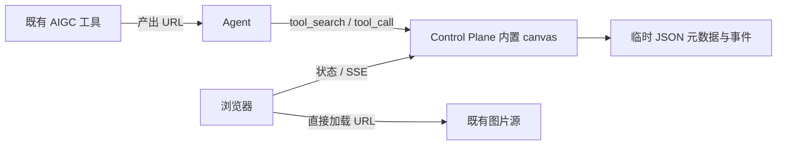

# 设计：Agent 实时画布工具（URL-only，临时 JSON 存储）

状态：待评审，2026-11-12 修订。本轮只写方案，没有实现、注册工具、迁移资源或部署服务。用户已确定文件系统存储与下列默认值，不再逐项等待确认。

**用户已明确：我们不处理图片文件，只拿到可以访问的 URL。** 因此取消初稿的图片上传、下载、托管存储、转码、文件清理和独立 canvas 进程方案。画布只管理展示记录，浏览器直接加载图源。

**存储使用 JSON 文件 + 内存，不使用数据库。** `CANVAS_DATA_DIR` 默认 `/tmp`（可配置），在其下使用专属 `agent-bridge-canvas/` 子目录；默认数据是可丢弃的实时展示状态，主机重启后按已清空设计。确需持久时才显式选用 OpenList share 的文件系统目录。

依据：[AGENTS.md](../AGENTS.md)、[技能库设计](agent-skills-design.zh.md)、[中央工具库](tool-hub-design.zh.md)、[控制面架构](v0.7-server-architecture.zh.md)、[审批与权限](approval-permissions.zh.md)。已只读核对归档 kindergarten-menu / imaginarium 的 `dashboard/canvas.py`、`canvas_page.py`、`server.py`、`data.py`，以及 Bridge 的工具库、SSE 和网页接入代码。本次仅独立修订本文，不改写已推送提交。

## 1. 推荐结论

**直接在 Control Plane 内置 canvas 工具与轻量网页，不新增独立服务。** Agent 经已有 `/mcp/tools` 创建画布、追加图片 URL、更新状态；浏览器通过普通 HTTP/SSE 取得展示记录，并直接向图片来源取图。

| 决策 | 本版默认值（部署参数、档位与限额可配置） |
| --- | --- |
| 定位 | Agent 的实时展示工具；生成仍由既有 AIGC 工具负责 |
| 运行位置 | 复用 Control Plane 进程与 HTTP 入口 |
| 存储 | `/tmp/agent-bridge-canvas/`，每画布一个目录，JSON 保存轻量元数据；无数据库、无图片字节 |
| 实时通道 | 浏览器 SSE，与 MCP 调用解耦；断线按游标补差 |
| 生命周期 | 临时数据不承诺跨主机重启保留；文件仍在时可跨服务重启恢复；图片有效期由来源负责 |
| 权限与 owner | 正常读写 `auto`，仍校验身份、配额及风险规则；owner 来自认证 principal，同一 principal 下会话可共同操作 |
| 暴露面 | 复用既有受控 HTTPS 入口的 `/canvas/`，不新增端口 |

首期保留全屏、淡入切换、标题/说明、状态点、键盘导航和幻灯片；移除旧生成面板。视频、任意 HTML、图床和协同编辑器不进入首期。

## 2. 为什么不再推荐单独进程

| 方案 | 结论 |
| --- | --- |
| 恢复旧工作台，外包 MCP | 带回已归档生成依赖和旧 `/api/files`，不采用 |
| 独立 HTTP/MCP 服务 | 可独立部署，但少量 URL 元数据不足以抵偿新增进程、权限与部署成本 |
| 内置工具 + 按需进程 | 适合处理大文件的前提；用户已排除图片文件处理，本版不采用 |
| **Control Plane 内置工具 + 薄网页** | **推荐**，复用已有身份、发现、HTTP 与 SSE，增加小型文件存储模块 |

MCP 是 Agent 的操作入口，不代替浏览器网页或 SSE。追加工具提交后立即返回，不挂起整个生成任务。



## 3. 归档中可保留的部分

`CanvasService` 的创建、查询、追加和通知职责很独立；旧页面的纯展示 HTML/CSS/DOM 可以小范围移植。工作台 server 依赖完整生成流水线，不能直接启用。

需要重新定义：旧服务启动读入所有 JSON、每次追加重写整张画布；旧 SSE 只有内存队列，没有事件 ID；页面初次查询与订阅之间可能漏消息，重连又整张重读；本地路径依赖 `/api/files?path=...`。新方案按需加载单个画布，每次变化原子写入一个小 JSON 记录，只接收绝对 HTTP(S) URL，不保留路径、base64 或文件代理。

页面只加载当前图及必要相邻图，避免进入长画布就下载所有原图。缩略图 URL 可由调用方提供并懒加载；没有时可用编号列表，不在服务端生成缩略图。现有 Bridge 附件库及其默认保留期不参与本功能。

## 4. 资源存储：引用属于画布，文件属于来源

### 输入与可达性

图片最小输入为 `url`，可选标题、说明、来源标识、`expires_at` 和 `thumbnail_url`。**可访问指打开页面的浏览器可直接加载**，不能只在产图机器或 Control Plane 上可达。

后端仅校验 URL 语法、HTTP(S) 协议、长度及元数据大小；不发 HEAD/GET 探活，不生成代理地址。拒绝本地路径、`file:`、`data:`、`javascript:` 和 URL 内用户名/密码。HTTPS 页面需 HTTPS 图源；需要自定义认证头的地址应由来源转换成浏览器可直接使用的 URL。内网 URL 取决于浏览器所在网络，`localhost` 不能表示另一台机器。

普通跨源 `` 展示通常不要求图源 CORS；首期不读取图片像素或生成网页截图。加载失败显示占位，允许用户重试，不自动下载、复制或代理解决。

### URL 过期与变化

- 稳定 URL 的可用性由图源保证，画布不定时探测。
- 临时 URL 可标记有效期；过期提示由页面展示。Agent 从原工具取得新地址后，按稳定 `image_id` 更新 URL，保留顺序和说明，只产生一个更新事件。
- 未提供有效期时不猜测。相同 URL 背后的字节若变化，来源应给版本化 URL；画布不下载算哈希，也不主动加随机查询参数绕过缓存。
- 图像缓存由浏览器和源站的 HTTP 头控制，Control Plane 不存图片副本。

带签名的 URL 可能授予限时访问能力，只保存在受保护的运行 JSON 文件，不进 Git、共享技能或长期记忆；日志和审批展示遮盖签名参数。获准查看画布的浏览器必然拿到完整 URL。页面设置 `Referrer-Policy: no-referrer`，避免向图源发送画布地址。

### 目录与文件布局

`CANVAS_DATA_DIR` 的默认值为 `/tmp`，实际文件放在其专属子目录，避免散落在 `/tmp` 根部。此配置只决定元数据位置，不改变浏览器取图地址。

```text
<CANVAS_DATA_DIR>/agent-bridge-canvas/   # 默认 /tmp/agent-bridge-canvas/
  store.json                          # 格式版本、随机 store_epoch
  .writer.lock                        # 进程级独占文件锁，不以文件存在判断锁
  canvases/<canvas-id>/
    records/000000000001.json          # 创建：canvas_epoch、owner、初始状态、幂等回执
    records/000000000002.json          # 一次追加/更新/状态操作及其回执
    records/000000000003.json          # 后续操作，文件名即递增 seq
    snapshot.json                     # 可重建的状态快照、seq、幂等索引
    records/.<unique>.tmp             # 写入中的临时文件，不可见为已提交操作
    .snapshot.<unique>.tmp            # 快照临时文件
```

每个操作 JSON 同时保存 `store_epoch`、`canvas_epoch`、画布 ID、`seq`、操作类型、变化字段、revision、幂等键摘要、规范化参数摘要和结果概要。第一条创建记录含随机生成的 canvas_epoch、owner 和初始标题/状态；追加记录含稳定图片 ID、URL、说明和顺序；更新记录只含被修改条目的变化。**一条记录就是一个提交单位**，不把状态、事件和幂等回执拆成必须同时成功的多个文件。

快照包含两个 epoch，以及截至指定 seq 的标题、owner、状态、图片描述列表、revision 和幂等索引，是加速读取的派生文件。默认每 256 个提交生成一次（可配置），在写入路径上触发，无后台定时器；生成失败不撤销已经提交的操作。快照不包含历史事件副本，也不触发历史记录删除。

内存只缓存热画布的状态、幂等索引和有限事件，缓存有界、空闲可释放。再次访问按需读该画布的快照及之后的记录；SSE 补差直接按 seq 文件名读取需要的区间。列画布时分页读取目录项及所需摘要，不在启动或重连时加载整个数据根。首期不压缩/删除记录，不引入数据库、全局索引服务或自动备份任务。

### 并发、原子写与故障边界

同一数据根只允许一个 Control Plane 进程写入；模块取得操作系统级独占文件锁，随进程退出自动释放，取锁失败时不开放该目录的 canvas 写入。进程内按 `canvas_id` 使用异步互斥锁，不同画布可以并行。读快照、校验 revision、分配 seq 和写提交都以同一把画布锁协调；SSE 网络发送在锁外进行。

一次写操作按以下顺序完成：

1. 核对目录代次、身份、幂等键、revision 与配额。同键同内容返回原回执，不再写文件；同键不同参数报冲突。幂等查找在速率限制之前，成功调用重试不会被误当成新进度更新。
2. 在画布锁内计算下一 seq 和变更记录。临时文件与最终文件位于同一目录、同一文件系统，以独占创建写入完整 JSON 后关闭文件，再 `rename` 成最终 seq 文件；不能跨文件系统移动充当原子提交。
3. **最终记录的 rename 成功就是提交点**。在此之前不修改对外可见的内存状态、不发 SSE、不返回成功。提交后更新内存、通知订阅者并返回回执。目标 seq 文件若已存在，核对并恢复提交状态，不覆盖旧记录。
4. 需要快照时也用临时文件 + rename 替换 `snapshot.json`，在画布锁内串行完成，不能用较旧快照覆盖较新快照。快照落后可补后续记录，不影响提交是否成立。

创建同样幂等：画布 ID 由 `store_epoch + principal + create 幂等键` 稳定派生，第一条记录原子提交后才算创建成功，避免为创建另维护一份需要双写的全局索引。写一半留下的临时文件/空目录不算画布；读取只认完整最终记录。数据根丢失后生成新 store_epoch；仅单个画布目录丢失后显式重建，也必须生成新 canvas_epoch，不能因 ID 相同就把旧游标接到新历史上。追加/更新不会自动重建丢失画布。

| 故障时刻 | 处理 |
| --- | --- |
| rename 前中断 | 没有已提交操作；临时文件不参与恢复，相同幂等键可重试 |
| rename 后、回包或 SSE 前中断 | 文件中已有变化和回执；从快照/记录恢复，重试返回该结果，SSE 按游标补齐 |
| 快照缺失或落后 | 读取该画布已提交记录恢复，不回退已提交 seq |
| 最终记录损坏、缺号或代次不符 | 报存储错误并停止该画布写入，不跳号、静默回滚或覆盖文件 |
| `/tmp` 被清空 | 失效内存缓存与旧游标，返回 `canvas_gone`，由调用方新建画布，不从缓存偷偷复活 |

临时模式只承诺同文件系统 rename 的原子可见性，不承诺掉电持久性。选择持久模式时，提交成功还需在 rename 前同步文件、rename 后同步父目录；同步结果不确定时要求同幂等键核对恢复，不能返回未经确认的持久成功。`store.json` 也通过临时文件 + rename 初始化。目录/文件默认权限为 `0700`/`0600`，路径仅使用服务端生成的 ID，不跟随调用方路径或符号链接。

### 所有权

owner 来自认证 principal，不能由模型自报。来源会话 ID 仅用于追踪。默认同一 principal 下会话可共同操作；跨 principal 协作留待后续，不增加本轮确认项。工具可发现不等于所有画布都可读写。读取缓存时也核对数据根代次及目标提交文件是否仍在，不能用内存掩盖临时目录已经被清空。

## 5. 工具、网页与合法注册

| 工具 | 作用 |
| --- | --- |
| `canvas.create` | 创建，返回 `canvas_id`、`view_url`、游标 |
| `canvas.list` / `canvas.get` | 分页摘要/图片描述，或游标之后的变化 |
| `canvas.add_image` | 追加 URL 与说明，只返回新增记录和游标 |
| `canvas.update_image` | 按 image_id 和预期 revision 更新 URL/说明，保持顺序 |
| `canvas.set_status` | 更新 working/complete/failed 和简短状态说明 |
| `canvas.close` / `canvas.open` | 显式结束/重新打开实时展示，关闭不删除记录 |

所有写工具接受幂等键：同键同内容返回原结果，同键不同内容报冲突。更新检查 revision，避免并发覆盖。complete/failed 只改状态，关闭标记另行管理。

典型流程：创建并交给用户链接 → Agent 调既有 AIGC 工具 → 每产出一个 URL 就追加 → 更新状态 → 完成后关闭。画布不负责调用模型，也不另开 Agent。

### 中央工具库注册

在 Control Plane 定义静态 `CANVAS_TOOLS` schema 和处理函数，为 `ToolHub` 增加 canvas 分支；私有登记表使用 `transport.builtin: canvas`。当前代码只认识已有内置分支，**单加登记表不会自动实现工具**。

继续经 `/mcp/tools` 的 `tool_search` / `tool_call` 调用，不新增公开 `/mcp/canvas` 或各机器 MCP 配置。搜索静态描述不读图源、不加载所有画布。pinned 只影响开局提示，实际置顶作用域留在私有配置。

正常读写默认 `auto`（登记表可配置），身份和配额仍需校验。当前 web/decide 分支在通用风险判断前提前执行；canvas 写工具必须先经过风险决策，不能照搬该快捷路径。调用身份取自 `mcp/tools.ts` 已认证后交给 `ToolHub.call` 的 principal。这是已收敛的默认值，本轮只写方案，不实际修改登记表或权限。

首期不提供图片上传、下载、代理或删除源资源工具。画布记录清理后续可增加具体范围预览与人工确认入口；不能把模型的 `confirmed=true` 当作人的授权。

### 网页与暴露面

`/canvas/{id}/` 提供薄页面；其下 `/state`、`/images`、`/events` 提供状态、分页描述与 SSE；`/canvas-static/*` 提供 JS/CSS。没有图片代理路由。链接从部署配置生成，不写死个人域名。

默认复用 Control Center 的受控浏览器入口模型（由部署配置提供内网/VPN或既有访问网关保护），服务端赋予只读 principal，页面不持有 Agent token。数据请求使用同源校验、自定义请求头和禁止 CORS 的机制，只开放 canvas 读取。画布 ID 不充当密码；能进入受控浏览器入口的人可查看画布，Agent 工具侧仍按 owner 校验。

当前 `web/api.ts` 依赖网络/网关边界，并非独立用户登录系统。本方案明确沿用这一信任边界；若未来要对边界之外分享，再设计画布级只读授权，不在首期增加登录与分享凭据系统。

默认复用现有 HTTPS 入口与监听，不增加独立端口；入口地址可配置，实际域名部署前确认。公网域名上的 canvas 路径必须受既有网关保护。只在 canvas 页面 CSP 放行所需 HTTP(S) 图源，不能直接沿用 Control Center 的 `img-src 'self' data:`，也不放宽整个控制面的 CSP。

## 6. SSE：独立于 MCP，按游标恢复

每个已提交操作使用画布递增 seq；游标带 store_epoch、canvas_epoch、画布 ID 和序号，事件只含 URL/说明或状态变化。服务重启且文件还在时保持两个 epoch；数据根或单个画布重建时更换相应 epoch，旧游标不能接到新历史上。代次不符返回 `canvas_gone`；调用方需显式打开新画布代次。

1. 页面读取状态和首张图片描述页，在画布锁内从已提交的内存投影取得一致副本与高水位 S；缓存未命中先从该画布文件恢复。
2. 以 Last-Event-ID 或初次 after=S 连接 SSE，只读取 seq>S 的已提交 JSON 记录，覆盖查询与订阅之间的写入。
3. 服务端在画布锁内安装唤醒监听并取得当前高水位，锁外补历史，补完重查最新序号；通知只负责唤醒，最终记录文件才是事实来源，不持锁等待浏览器。
4. 页面成功应用事件后推进游标。重连只补缺失区间，按 image_id/revision 处理重复投递；不能全量重发再依赖页面去重。
5. 历史图片按稳定顺序分页，每行带 revision。分页行可能比 S 更新，只接受更高版本；分页不推进 SSE 游标，仍经事件完整追上状态，不跨多次请求持有画布锁。

普通重连不重读整张画布；无变化只有小心跳。内存未缓存某段事件时按 seq 读取那几个 JSON 文件，不扫描其他画布。完全相同状态不产生重复可见事件；若操作仅需保存新的幂等回执，可提交 receipt/noop 记录，SSE 仅推进游标、不重复渲染状态。

首期记录文件与画布一起保留到临时数据丢失或获准删除。画布仍在但游标非法/超前时返回 `resync_required`，先比较 revision，再用分页 ID/revision 清单补差；数据已清空则返回 `canvas_gone` 并停止重连，不假装能补回已丢失历史。新浏览器无本地状态时才取初始分页快照。

页面采用 fetch SSE，支持同源请求头、错误状态和中止。断线指数退避；隐藏页面断开，恢复可见用最后游标补齐，不并行全量轮询。关闭画布后停止 SSE、保留展示；再次访问/恢复可见时检查是否重新打开。

通知和序列化按画布共享，慢消费者缓冲有界，背压超预算即断开，随后从游标恢复。心跳不写文件、不增加 seq；断开即清除监听器与 timer。

## 7. 生命周期、配额与空闲

| 对象 | 规则 |
| --- | --- |
| 图片文件 | 完全由来源负责，canvas 从不创建或删除 |
| URL | 有效期由来源决定；过期标记、显式替换，不自动续签 |
| 默认数据目录 | `CANVAS_DATA_DIR=/tmp`，专属子目录存 JSON；临时、默认不持久 |
| 画布记录 | 与会话/页面寿命解耦，但只在文件仍在时有效，不承诺跨主机重启保留 |
| 关闭任务 | 只冻结追加并停止实时展示，不主动删除文件，不延长临时目录寿命 |
| 清理 | 用户已接受 `/tmp` 在主机重启/系统清理时丢失；应用不另加 TTL 删除任务或清理其他目录；主动删除仍需明确授权 |
| 可选持久位置 | 显式配置 OpenList share 的文件系统目录后保留元数据；不开自动同步/迁移 |

默认持久性边界是“主机重启后可以全部丢失”，用户已经接受。即使某台机器的 `/tmp` 偶尔跨重启保留，也不据此提供持久承诺；系统临时文件清理也可能提前移除它。只重启 Control Plane 不主动删除数据，文件完整时按需恢复；数据丢失后重新创建画布，旧链接/游标失效，幂等保证也仅覆盖尚存的那一代文件。服务启动不扫描全部画布、不从旧工作台或图源恢复。

确需持久时，把 `CANVAS_DATA_DIR` 显式设为 OpenList share 对应的实际本地文件系统路径，并启用 `CANVAS_DURABLE=true`（默认 `false`，可配置），采用前述同步文件/目录的写入方式。share 必须支持同目录原子 rename 与所需文件锁/同步语义；HTTP 分享链接不能直接当文件目录，不能用 WebDAV 覆盖上传假装原子替换。具体 share 路径由部署配置提供，本轮不猜路径、不探测挂载、不迁移数据。更换目录视为切换数据集，不自动双写或全量同步。

以下均为**默认值，可配置**，不再等待逐项拍板：

| 配置 | 默认值 | 行为 |
| --- | --- | --- |
| `CANVAS_MAX_IMAGES` | 500 张/画布 | 达限额拒绝追加 |
| `CANVAS_MAX_URL_BYTES` | 8 KiB | 按 UTF-8 字节数校验，每个 URL 字段均受限 |
| `CANVAS_MAX_DESCRIPTION_BYTES` | 4 KiB | 按 UTF-8 字节数校验单条说明 |
| `CANVAS_PROGRESS_INTERVAL_MS` | 1000 ms | 同一画布、同一任务状态的进度更新最多 1 次/秒；完全相同内容不重复显示，切换 complete/failed 可立即提交 |
| `CANVAS_SNAPSHOT_EVERY` | 256 个提交 | 按写入次数生成快照，无定时全量重写 |

达到限额或更新过快返回明确错误及适用的重试时间，不静默淘汰记录。元数据文件与内存缓存仍需有容量边界；源图文件不属于 canvas 配额。幂等重试只返回已有回执，不重复计入图片数或进度频率。

Control Plane 已因 Bridge WebSocket 和调度常驻。本方案不新增低频常驻服务，也不把整个控制面改成按网页访问退出。canvas 无请求/无 SSE 时不保留全量缓存、不运行轮询、清理或探活任务；新增 timer 均 unref 并在连接释放时清除。承诺的是没有新增后台工作，不能把已有控制面占用称为零。

如果以后确有独立部署需求，再按 systemd socket activation + idle-exit 拆分：fd 3、请求/SSE 持有活动引用、最后释放后退出、socket 保留、timer unref、Restart=on-failure。已参考 go-hikaru `apps/server/src/main.ts`、`idle.ts`。当前 URL-only 方案不创建这套新服务。

默认没有备份需求或备份任务。可选持久目录只保留 URL 元数据，不能保存已过期 URL 所指向的图片；若后续要迁移/备份该目录，另按明确范围进行，不把它加入控制面数据库备份或默认搬运图片。

## 8. 目录与技能归属

建议实现布局，本轮仅修改本文：

```text
docs/canvas-design.zh.md                 # 设计与后续决策
apps/control-plane/src/canvas.ts         # 元数据业务、事件、幂等
apps/control-plane/src/canvas-store.ts   # JSON 记录/快照、画布锁、原子写、按需恢复
apps/control-plane/src/canvas-tools.ts   # schema、身份、工具处理
apps/control-plane/src/web/canvas.ts     # 页面、只读 API、SSE
apps/control-plane/canvas-web/           # 薄 HTML/CSS/JS 与构建入口
tests/canvas-*.test.ts                   # 实施后的行为验证
```

现有工具库、路由、配置和构建脚本做小范围接线；不新增数据库表或迁移，不增加 apps/canvas、systemd 单元或图片目录，不改 DSH 或归档代码。

设计放项目 docs，符合技能库现行约定；不再向历史 shared-skills 添加内容。技能库文档开头已取消的 Bridge 同步阶段优先于正文历史规划。

工具运行不依赖技能。以后若需要跨项目操作手册，可经 Control Plane 的 skill_write 写入私有库 `scopes/<scope>/<category>/<skill>/SKILL.md`，仅说明操作流程，不直接改技能 checkout 或重复包装项目设计。实际域名、置顶作用域和登记表留在私有配置，权限按既有提案/确认流程调整。

## 9. 验收与交付

| 场景 | 验收 |
| --- | --- |
| URL-only | 追加、查询、恢复均无后端图源请求或图片落盘，无上传/代理入口 |
| 实时展示 | 追加后立即显示，浏览器直接取图 |
| 失效/替换 | 失败占位；换 URL 只更新一条事件，ID 与顺序保持 |
| 幂等/并发 | 同键不重复追加，异内容冲突，revision 冲突不覆盖 |
| 原子写中断 | rename 前无已提交操作；rename 后回包丢失能恢复同一回执；不会出现状态成功而幂等/事件缺失 |
| 多画布/多进程 | 同画布写入串行，不同画布可并行；第二个写进程无法取得同一数据根的独占锁 |
| 文件恢复 | 服务重启后只加载被访问画布的快照和尾部记录，seq、revision、幂等结果一致；最终记录损坏不静默跳过 |
| 断线差量 | 已有 100 条、离线新增 3 条，重连只补 3 条 |
| 查询/订阅竞态 | 中间写入不漏，旧分页不覆盖新版本 |
| 浏览器边界 | 同源受控只读入口正常，外源脚本不能读，无 Agent token 泄露，CSP 允许图源 |
| 空闲 | 无 canvas 监听/timer 泄漏、轮询或图源探测 |
| 临时生命周期 | 会话结束、关闭与 URL 过期不主动删文件；清空测试数据根或单个画布目录后旧游标返回 canvas_gone，缓存不复活数据；重建不复用旧代次 |
| 可选持久目录 | 原子 rename/同步语义验证通过后才启用；切换路径不自动同步，仍无图片落盘 |

评审通过后再实施。实现涉及 Control Plane，需升根版本；不涉及数据库迁移，预计也不改 Bridge 运行时，因此不升 Bridge 版本、不触发 fleet 自更新。代码提交推送后，从干净 checkout 走正式 HAL 部署和验证；本文本身不升版本、不部署。

本轮已收敛的关键决策：**直接内置 Control Plane；只引用 URL；JSON + 内存，默认 `/tmp` 临时数据；正常读写 auto 但经过风险决策；owner 来自 principal；复用受控浏览器入口；使用上述可配置默认限额。** 仍待整体方案评审，不执行实现；实际域名及选用持久模式时的 share 路径留到部署配置。
