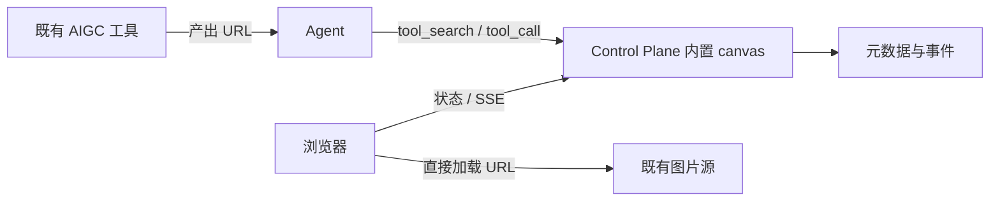

# 设计：Agent 实时画布工具（URL-only）

状态：待评审，2026-11-12 修订。本轮只写方案，没有实现、注册工具、迁移资源或部署服务。

**用户已明确：我们不处理图片文件，只拿到可以访问的 URL。** 因此取消初稿的图片上传、下载、托管存储、转码、文件清理和独立 canvas 进程方案。画布只管理展示记录，浏览器直接加载图源。

依据：[AGENTS.md](../AGENTS.md)、[技能库设计](agent-skills-design.zh.md)、[中央工具库](tool-hub-design.zh.md)、[控制面架构](v0.7-server-architecture.zh.md)、[审批与权限](approval-permissions.zh.md)。已只读核对归档 kindergarten-menu / imaginarium 的 `dashboard/canvas.py`、`canvas_page.py`、`server.py`、`data.py`，以及 Bridge 的工具库、数据库、SSE 和网页接入代码。初稿随并行提交 `ead4d01` 入库，本次只独立修订本文。

## 1. 推荐结论

**直接在 Control Plane 内置 canvas 工具与轻量网页，不新增独立服务。** Agent 经已有 `/mcp/tools` 创建画布、追加图片 URL、更新状态；浏览器通过普通 HTTP/SSE 取得展示记录，并直接向图片来源取图。

| 决策 | 推荐 |
| --- | --- |
| 定位 | Agent 的实时展示工具；生成仍由既有 AIGC 工具负责 |
| 运行位置 | 复用 Control Plane 进程、HTTP 入口和数据库 |
| 存储 | 只存标题、URL、说明、顺序、状态、游标及幂等记录；无图片字节 |
| 实时通道 | 浏览器 SSE，与 MCP 调用解耦；断线按游标补差 |
| 生命周期 | 画布记录默认保留，独立于会话/进程；图片有效期由来源负责 |
| 暴露面 | 复用既有受控 HTTPS 入口的 `/canvas/`，不新增端口 |

首期保留全屏、淡入切换、标题/说明、状态点、键盘导航和幻灯片；移除旧生成面板。视频、任意 HTML、图床和协同编辑器不进入首期。

## 2. 为什么不再推荐单独进程

| 方案 | 结论 |
| --- | --- |
| 恢复旧工作台，外包 MCP | 带回已归档生成依赖和旧 `/api/files`，不采用 |
| 独立 HTTP/MCP 服务 | 可独立部署，但少量 URL 元数据不足以抵偿新增进程、权限与部署成本 |
| 内置工具 + 按需进程 | 适合处理大文件的前提；用户已排除图片文件处理，本版不采用 |
| **Control Plane 内置工具 + 薄网页** | **推荐**，复用已有身份、发现、HTTP、SQLite 与 SSE |

MCP 是 Agent 的操作入口，不代替浏览器网页或 SSE。追加工具提交后立即返回，不挂起整个生成任务。



## 3. 归档中可保留的部分

`CanvasService` 的创建、查询、追加和通知职责很独立；旧页面的纯展示 HTML/CSS/DOM 可以小范围移植。工作台 server 依赖完整生成流水线，不能直接启用。

需要重新定义：旧服务启动读入所有 JSON、每次追加重写整张画布；旧 SSE 只有内存队列，没有事件 ID；页面初次查询与订阅之间可能漏消息，重连又整张重读；本地路径依赖 `/api/files?path=...`。新方案改用元数据事务与持久事件，只接收绝对 HTTP(S) URL，不保留路径、base64 或文件代理。

页面只加载当前图及必要相邻图，避免进入长画布就下载所有原图。缩略图 URL 可由调用方提供并懒加载；没有时可用编号列表，不在服务端生成缩略图。现有 Bridge 附件库及其默认保留期不参与本功能。

## 4. 资源存储：引用属于画布，文件属于来源

### 输入与可达性

图片最小输入为 `url`，可选标题、说明、来源标识、`expires_at` 和 `thumbnail_url`。**可访问指打开页面的浏览器可直接加载**，不能只在产图机器或 Control Plane 上可达。

后端仅校验 URL 语法、HTTP(S) 协议、长度及元数据大小；不发 HEAD/GET 探活，不生成代理地址。拒绝本地路径、`file:`、`data:`、`javascript:` 和 URL 内用户名/密码。HTTPS 页面需 HTTPS 图源；需要自定义认证头的地址应由来源转换成浏览器可直接使用的 URL。内网 URL 取决于浏览器所在网络，`localhost` 不能表示另一台机器。

普通跨源 `` 展示通常不要求图源 CORS；首期不读取图片像素或生成网页截图。加载失败显示占位，允许用户重试，不自动下载、复制或代理解决。

### URL 过期与变化

- 稳定 URL 的可用性由图源保证，画布不定时探测。
- 临时 URL 可标记有效期；过期提示由页面展示。Agent 从原工具取得新地址后，按稳定 `image_id` 更新 URL，保留顺序和说明，只产生一个更新事件。
- 未提供有效期时不猜测。相同 URL 背后的字节若变化，来源应给版本化 URL；画布不下载算哈希，也不主动加随机查询参数绕过缓存。
- 图像缓存由浏览器和源站的 HTTP 头控制，Control Plane 不存图片副本。

带签名的 URL 可能授予限时访问能力，只保存在受保护的运行数据库，不进 Git、共享技能或长期记忆；日志和审批展示遮盖签名参数。获准查看画布的浏览器必然拿到完整 URL。页面设置 `Referrer-Policy: no-referrer`，避免向图源发送画布地址。

### 元数据布局与所有权

在现有、位于 Git checkout 外的 Control Plane SQLite 中增加 `canvases`、`canvas_images`、`canvas_events`、`canvas_idempotency` 表，不新建图片目录或对象存储。

画布保存 ID、owner、标题、状态、关闭标记、时间和递增 `seq`；图片保存稳定 ID、顺序、URL、说明和 revision。每次变更在一个短事务内更新记录、序号、事件与幂等回执，提交后才通知 SSE。不加载全量画布到内存，也不重写整张文档。

owner 来自认证 principal，不能由模型自报。来源会话 ID 仅用于追踪。所有 Agent 可发现工具，已有画布按身份授权；首期同一 agent principal 下的会话可共同操作，不承诺当前工具上下文尚不具备的严格会话隔离。跨 principal 协作可后续增加明确成员授权。

## 5. 工具、网页与合法注册

| 工具 | 作用 |
| --- | --- |
| `canvas.create` | 创建，返回 `canvas_id`、`view_url`、游标 |
| `canvas.list` / `canvas.get` | 分页摘要/图片描述，或游标之后的变化 |
| `canvas.add_image` | 追加 URL 与说明，只返回新增记录和游标 |
| `canvas.update_image` | 按 image_id 和预期 revision 更新 URL/说明，保持顺序 |
| `canvas.set_status` | 更新 working/complete/failed 和简短状态说明 |
| `canvas.close` / `canvas.open` | 显式结束/重新打开实时展示，关闭不删除记录 |

所有写工具接受幂等键：同键同内容返回原结果，同键不同内容报冲突。更新检查 revision，避免并发覆盖。complete/failed 只改状态，关闭标记另行管理。

典型流程：创建并交给用户链接 → Agent 调既有 AIGC 工具 → 每产出一个 URL 就追加 → 更新状态 → 完成后关闭。画布不负责调用模型，也不另开 Agent。

### 中央工具库注册

在 Control Plane 定义静态 `CANVAS_TOOLS` schema 和处理函数，为 `ToolHub` 增加 canvas 分支；私有登记表使用 `transport.builtin: canvas`。当前代码只认识已有内置分支，**单加登记表不会自动实现工具**。

继续经 `/mcp/tools` 的 `tool_search` / `tool_call` 调用，不新增公开 `/mcp/canvas` 或各机器 MCP 配置。搜索静态描述不读图源、不加载所有画布。pinned 只影响开局提示，实际置顶作用域留在私有配置。

正常读写建议 `auto`，身份和配额仍需校验。当前 web/decide 分支在通用风险判断前提前执行；canvas 必须复用风险决策再执行，不能照搬该快捷路径。调用身份取自 `mcp/tools.ts` 已认证后交给 `ToolHub.call` 的 principal。风险档和登记表变更属于待评审材料，本轮不改权限。

首期不提供图片上传、下载、代理或删除源资源工具。画布记录清理后续可增加具体范围预览与人工确认入口；不能把模型的 `confirmed=true` 当作人的授权。

### 网页与暴露面

`/canvas/{id}/` 提供薄页面；其下 `/state`、`/images`、`/events` 提供状态、分页描述与 SSE；`/canvas-static/*` 提供 JS/CSS。没有图片代理路由。链接从部署配置生成，不写死个人域名。

首期复用 Control Center 的受控浏览器入口模型：由内网/VPN或既有访问网关保护，服务端赋予只读 principal，页面不持有 Agent token。数据请求使用同源校验、自定义请求头和禁止 CORS 的机制，只开放 canvas 读取。画布 ID 不充当密码；能进入受控浏览器入口的人可查看画布，Agent 工具侧仍按 owner 校验。

当前 `web/api.ts` 依赖网络/网关边界，并非独立用户登录系统。本方案明确沿用这一信任边界；若未来要对边界之外分享，再设计画布级只读授权，不在首期增加登录与分享凭据系统。

复用现有 HTTPS 域名与监听，不增加独立端口。实际域名与访问范围部署前确认；公网域名上的 canvas 路径必须受既有网关保护。只在 canvas 页面 CSP 放行所需 HTTP(S) 图源，不能直接沿用 Control Center 的 `img-src 'self' data:`，也不放宽整个控制面的 CSP。

## 6. SSE：独立于 MCP，按游标恢复

事件使用画布递增 seq；游标带存储 epoch、画布 ID 和序号。普通重启保持 epoch，恢复较旧备份时换 epoch。事件只含 URL/说明或状态变化等元数据。

1. 页面读取状态和首张图片描述页，同一读事务返回高水位 S。
2. 以 Last-Event-ID 或初次 after=S 连接 SSE，查询 seq>S 的持久事件，覆盖查询与订阅之间的写入。
3. 服务端先安装唤醒监听，再补历史，补完重查最新序号；通知只负责唤醒，数据库才是事实来源。
4. 页面成功应用事件后推进游标。重连只补缺失区间，按 image_id/revision 处理重复投递；不能全量重发再依赖页面去重。
5. 历史图片按稳定顺序分页，每行带 revision。分页行可能比 S 更新，只接受更高版本；分页不推进 SSE 游标，仍经事件完整追上状态，避免持有长期 SQLite 事务。

普通重连不重读整张画布；无变化只有小心跳。首期事件跟随画布保留，避免短 TTL 导致反复重建。未知 epoch、非法/超前游标返回 resync_required，先比较 revision，再用分页 ID/revision 清单补差；新浏览器无本地状态时才取初始分页快照。

页面采用 fetch SSE，支持同源请求头、错误状态和中止。断线指数退避；隐藏页面断开，恢复可见用最后游标补齐，不并行全量轮询。关闭画布后停止 SSE、保留展示；再次访问/恢复可见时检查是否重新打开。

通知和序列化按画布共享，慢消费者缓冲有界，背压超预算即断开，随后从游标恢复。心跳不落库、不增加 seq；断开即清除监听器与 timer。

## 7. 生命周期、配额与空闲

| 对象 | 规则 |
| --- | --- |
| 图片文件 | 完全由来源负责，canvas 从不创建或删除 |
| URL | 有效期由来源决定；过期标记、显式替换，不自动续签 |
| 画布记录 | 默认保留，独立于 Agent 会话、页面和服务进程 |
| 关闭任务 | 只冻结追加并停止实时展示，保留网页和历史 |
| 清理 | 只处理获准范围的元数据，不操作图源；未经授权不自动删除 |

元数据设置条数、字段长度、调用速率和总容量限额。建议首期 500 张/画布、URL 最多 8 KiB、说明最多 4 KiB，最终值可配置；相同状态不重复落事件，进度更新建议最多每秒一次。达到限额拒绝新增，不静默淘汰记录。源图文件占用不属于 canvas 配额。

Control Plane 已因 Bridge WebSocket 和调度常驻。本方案不新增低频常驻服务，也不把整个控制面改成按网页访问退出。canvas 无请求/无 SSE 时不保留全量缓存、不运行轮询、清理或探活任务；新增 timer 均 unref 并在连接释放时清除。承诺的是没有新增后台工作，不能把已有控制面占用称为零。

如果以后确有独立部署需求，再按 systemd socket activation + idle-exit 拆分：fd 3、请求/SSE 持有活动引用、最后释放后退出、socket 保留、timer unref、Restart=on-failure。已参考 go-hikaru `apps/server/src/main.ts`、`idle.ts`。当前 URL-only 方案不创建这套新服务。

备份沿用 SQLite 在线备份，放仓库外。备份恢复的是引用与展示历史，不能恢复已失效的外部图片地址。

## 8. 目录与技能归属

建议实现布局，本轮仅修改本文：

```text
docs/canvas-design.zh.md                 # 设计与后续决策
apps/control-plane/src/canvas.ts         # 元数据业务、事件、幂等
apps/control-plane/src/canvas-tools.ts   # schema、身份、工具处理
apps/control-plane/src/web/canvas.ts     # 页面、只读 API、SSE
apps/control-plane/canvas-web/           # 薄 HTML/CSS/JS 与构建入口
packages/database/src/canvas.ts          # 表、索引；接入既有迁移
tests/canvas-*.test.ts                   # 实施后的行为验证
```

现有工具库、路由、数据库迁移和构建脚本做小范围接线；不新增 apps/canvas、systemd 单元或图片目录，不改 DSH 或归档代码。

设计放项目 docs，符合技能库现行约定；不再向历史 shared-skills 添加内容。技能库文档开头已取消的 Bridge 同步阶段优先于正文历史规划。

工具运行不依赖技能。以后若需要跨项目操作手册，可经 Control Plane 的 skill_write 写入私有库 `scopes/<scope>/<category>/<skill>/SKILL.md`，仅说明操作流程，不直接改技能 checkout 或重复包装项目设计。实际域名、置顶作用域和登记表留在私有配置，权限按既有提案/确认流程调整。

## 9. 验收与交付

| 场景 | 验收 |
| --- | --- |
| URL-only | 追加、查询、恢复均无后端图源请求或图片落盘，无上传/代理入口 |
| 实时展示 | 追加后立即显示，浏览器直接取图 |
| 失效/替换 | 失败占位；换 URL 只更新一条事件，ID 与顺序保持 |
| 幂等/并发 | 同键不重复追加，异内容冲突，revision 冲突不覆盖 |
| 断线差量 | 已有 100 条、离线新增 3 条，重连只补 3 条 |
| 查询/订阅竞态 | 中间写入不漏，旧分页不覆盖新版本 |
| 浏览器边界 | 同源受控只读入口正常，外源脚本不能读，无 Agent token 泄露，CSP 允许图源 |
| 空闲 | 无 canvas 监听/timer 泄漏、轮询或图源探测 |
| 生命周期 | 会话结束、关闭与 URL 过期均不删除记录或操作图源 |

评审通过后再实施。实现涉及 Control Plane 与数据库，需升根版本；预计不改 Bridge 运行时，因此不升 Bridge 版本、不触发 fleet 自更新。代码提交推送后，从干净 checkout 走正式 HAL 部署和验证；本文本身不升版本、不部署。

本轮关键决策：**直接内置 Control Plane、只引用 URL、复用现有受控浏览器入口、元数据默认保留且删除先授权。** 接口和限额可在这些边界确认后细化。
