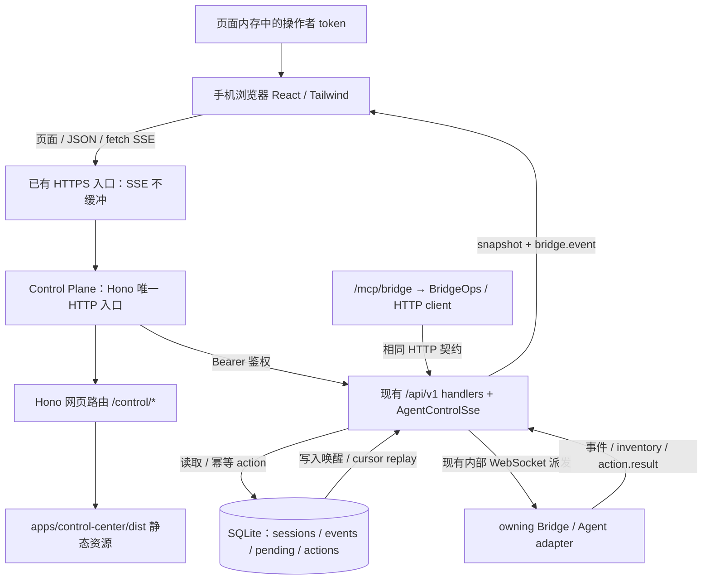

# Control Center 移动端网页设计

状态：Phase 1 + Phase 2 已在 `0.6.99` 上线；后续获批的内网直达/外网 CF Access 方案已在 `0.6.100` 上线（部署提交 `c56127e`），实际服务免登录/只读验收通过；证据与待验收项目见 [交付记录](control-center-mobile-delivery.md)。设计核对基线：2026-10-19，仓库根版本 `0.6.98`。

本文最初作为仅设计任务产出；后续已获批准实施 Phase 1 + Phase 2。下文保留设计决策，实际使用与构建见 [Control Center README](../apps/control-center/README.md)。前端首版合并为 `src/main.tsx`、`src/state.ts` 和 `src/api/`，正文采用安全纯文本；没有实现逐 token delta 或 Phase 3。本次已通过获准的 HAL 部署脚本上线；真机和真实 HTTPS 验收尚未完成。

## 1. 目标、假设与边界

面向手机浏览器，提供最近 session 列表、详情和历史对话、运行中事件流、打断当前 turn、新建对话，以及已有 session 的继续对话。复用 `/mcp/bridge` 工具的业务语义和控制面 `/api/v1`，不另建执行状态来源。

按当前代码作以下假设；存在取舍的地方明确保留限制：

- “移动端网页”指独立浏览器入口，不依赖 TokensCowork Desktop 或 DSH Host。0.6.100 起面向可通过内网或 Cloudflare Access 进入页面的操作者，不引入账户、多人权限或 OAuth。
- 手机通过已有可信网络入口访问控制面同源 HTTPS 地址；本方案不选择域名、不开放端口、不配置公网暴露。TLS 终止层必须支持 SSE、不缓冲响应。
- “内容流”指已持久化的完整消息、工具结果、进度与 turn 事件。当前没有文本/token delta，因此不能承诺打字机式逐 token 展示。若该效果是硬要求，需要另立协议扩展任务。
- “最近”默认指 `updatedAt` 降序，首屏 50 条，按需加载更多；不是只取今天，也不扫描所有会话。首版为平铺时间列表；以后增加项目分组时使用服务端 `/session-groups`，不在浏览器全量拉取后自行分组。
- 列表和已结束详情默认按进入、回到前台、手动刷新更新；不承诺停留在静态页面时立即发现其他客户端新启动的 turn。正在查看的活动 session 和本页发起的异步操作实时订阅。这是减少空闲连接的明确取舍。
- approvals / user inputs 首版展示状态和待办摘要，避免误以为 agent 卡住；完整处理界面可放下一阶段，不扩展为审批规则或自动审批项目。

## 2. 现状核查：HTTP 已经是业务入口

核查来源以代码为准：

| 来源 | 已确认内容 |
| --- | --- |
| `apps/control-plane/src/mcp/bridge.ts` | `/mcp/bridge` 的工具名是 `workers`、`sessions`、`session`、`create`、`turn`、`wait`、`pending`、`approve`、`answer`、`interrupt` |
| `apps/control-plane/src/mcp/bridge-ops.ts`、`bridge-client.ts` | MCP 的操作层以调用方的 Bearer 通过 loopback HTTP 调用 `/api/v1`，包括建立 SSE；还做 workspace 名称解析、等待 action、组合详情和精简响应 |
| `apps/control-plane/src/api/router.ts` | 列表、详情、历史事件、创建、提交 turn、interrupt、actions、pending 和 stream 均有 handler |
| `apps/control-plane/src/api/sse.ts` | SSE 在 `/api/v1/stream`，可用 `sessionId` 过滤，支持 cursor / `Last-Event-ID` |
| `apps/control-plane/src/config.ts` | 已有 read/write token 和 SSE 参数，默认监听 `0.0.0.0:8787` |
| `apps/control-plane/src/server.ts`、`http.ts`、`web/app.ts` | 一个 Hono 应用是唯一 HTTP 入口：`/api/v1`、`/control/api/v1`（浏览器）、`/control/*`（Control Center 静态页）、`/health`、`/memory/bootstrap`、`/mcp/*`；`/bridge` WebSocket upgrade 由 `ws` 在同一 server 上处理 |
| `packages/database/src/control.ts` | session 状态投影、事件分页、快照水位、可恢复流、action 结果的真实实现 |
| [Agent Control API 契约](agent-control-api.md) | `/api/v1` 的 wire types、错误、幂等和实时协议 |

**结论：不需要“把 MCP 改成 HTTP”，也不需要浏览器运行 MCP 客户端。** 前端直接调用已有 `/api/v1`，在薄适配层处理组合请求、字段和 UI 状态即可。控制面的 `/mcp/memory` 是对话档案/记忆/技能 MCP，`/mcp/bridge` 供 agent 驱动 session；两者都不是浏览器操作 session 的入口。

### 2.1 MCP 语义到 HTTP 的对应

下表路径均相对 `/api/v1`；URL ID 按单个 path segment 编码。

| 业务 / MCP 语义 | 已有 HTTP | 移动端用法 |
| --- | --- | --- |
| `workers` | `GET /workers` | 机器、agent、在线状态、能力、最近 workspace |
| `sessions` | `GET /sessions?sort=updatedAt&order=desc&limit=50` | 搜索、过滤、游标分页；不是历史 `/runs` |
| 首屏一致性 | `GET /snapshot?sessionLimit=50` | 同一读事务的 workers / sessions / pending / `streamCursor` |
| `session` | `GET /sessions/:id`，`GET /sessions/:id/events`，两个 pending 列表 | 组合详情、消息和待办；HTTP 返回完整资源，MCP 返回精简组合结果 |
| `wait` | `GET /stream?cursor=…`，必要时加 `sessionId=…` | 前端消费事件和状态，不增加 `/wait` 轮询接口 |
| `create` | `POST /sessions` | 创建，可携带首条 `input` |
| `turn` / submit_turn | `POST /sessions/:id/turns` | idle 开始新 turn；active 追加指令 |
| `interrupt` / interrupt_turn | `POST /sessions/:id/interrupt` | 附 `expectedTurnId`，只打断用户看到的 turn |
| 异步回执 | `GET /actions/:actionId`，SSE `action.updated` | `accepted` 不等于完成，跟踪最终执行结果 |
| `pending` | `GET /approvals?sessionId=…`、`GET /user-input?sessionId=…` | 注意 HTTP 路径是单数 `user-input` |
| `approve` | `POST /approvals/:id/decision` | 已存在，后续 UI 传 `{choice}` |
| `answer` | `POST /user-input/:id/response` | 已存在，传 `{answers:{[questionId]:{answers:[…]}}}` |

`GET /sessions/:id/events` 返回 JSON 历史分页，**不是 SSE**。当前代码还支持 `tail=true&limit=100`，返回最近一页且页内仍为时间正序；向前加载用 `tail=true&before=<nextCursor>`。普通向后补读使用 `after`。这两个方向的 `nextCursor` 不能混用；它们也不能用于 `/stream`。该 tail/before 能力在契约正文中说明不完整，实施时应补文档，无需新增 handler。

## 3. 代码位置、托管与路由

### 3.1 推荐：独立前端包，控制面同进程托管

新增 `apps/control-center` workspace 包：TypeScript + React + Vite + Tailwind，沿用 pnpm。独立包便于浏览器依赖、DOM 类型和打包与控制面的 Node TypeScript 编译隔离；不需要独立常驻服务。

建议结构（均未创建）：

```text
apps/control-center/
  package.json / vite.config.ts / tsconfig.json
  index.html
  src/
    app.tsx / styles.css
    pages/                 # Login、Sessions、SessionDetail、NewSession
    api/client.ts          # Bearer、错误、幂等请求
    api/stream.ts          # fetch SSE、重连、取消
    state/                 # 资源投影、历史合并、action 状态
  dist/                    # 构建产物，不进 git
apps/control-plane/src/web/
  app.ts                   # Hono 网页路由、响应头
  static.ts                # 受限静态目录、SPA fallback
```

由控制面托管编译后的静态资源：一个 Hono 应用是唯一的 HTTP 入口（经 `@hono/node-server` 的 request listener 挂在 Node server 上），`/api/v1`、`/health`、`/memory/bootstrap`、`/mcp/*` 与 `/control/*` 网页路由同在这棵路由里；所有异步异常仍须收敛为 HTTP 错误。

`AgentControlApi` 和原生 `IncomingMessage/ServerResponse` SSE 仍由原 handler 通过 `c.env.incoming/outgoing` 挂载，WebSocket upgrade 仍由 `ws` 处理，保留已验证的业务和流生命周期。API 请求体只由原 handler 消费，不先经 Hono body parser；SSE 不经过会缓冲整段响应的转换器。

### 3.2 参考 go-hikaru 的范围

已只读参考 `/root/projects/go-hikaru/apps/server`：

- `src/main.ts` 创建 Hono Node server，并支持 socket activation；`src/app.ts` 装配 API 和网页路由。
- `src/player.ts` 托管兄弟包 `apps/player/dist`，hash 资源长缓存，HTML 重验证，非 API 页面可 SPA fallback。
- `src/idle.ts` 用 hold/release 管理空闲退出，timer `unref`。

本项目复用其“兄弟前端包 + 服务端同源托管”的组织方式和缓存策略。控制面还有长期 Bridge WebSocket 和调度职责，不把整个控制面顺手迁成按网页访问启动/退出；本文也不新建后台索引、同步任务或服务。若以后确需拆出低频网页服务，再按 socket activation + idle-exit 设计，SSE 占用期间持有活动引用，服务端新增 timer 均 `unref`。

### 3.3 路由与静态资源规则

| 路由 | 行为 |
| --- | --- |
| `/control/` | 重定向到 `/control/sessions` |
| `/control/login` | 兼容旧地址，自动连接并进入会话列表 |
| `/control/api/v1/*` | 同源网页入口，服务端持有 token，包含 SSE；与静态路由分流 |
| `/control/sessions` | 最近会话列表；筛选可写入不含敏感内容的 query |
| `/control/sessions/:sessionId` | 详情、历史、实时状态、输入框、interrupt |
| `/control/new` | 选择 worker / workspace、首条消息 |
| `/control/assets/*` | Vite hash 资源；成功命中后 `public,max-age=31536000,immutable` |
| `/api/v1/*` | 既有 Bearer API；不改变路径和契约 |

Vite `base` 为 `/control/`。仅 `/control/` 下页面导航可 fallback 到 index；缺失 JS/CSS、非 GET/HEAD 和未知 API 返回真实 404，不返回 HTML。HTML 使用 `no-cache`；API、登录相关响应 `no-store`。静态资源根路径通过模块位置解析到兄弟包 `dist`，不依赖进程 cwd，禁止路径穿越。未构建时网页入口返回可读的 503；`/health` 和原 API 继续可用。

与“单独 Hono 服务”相比，同进程方案省去一个端口、鉴权代理、CORS 和服务生命周期。代价是未来网页后端发布随控制面发布；前端源码仍可独立开发。完整 Hono 路由迁移不属于首版必要工作。开发期 Vite 仅作为临时工具，同源 API 通过开发代理访问，token 不注入 Vite 环境或代理配置。

## 4. 手机界面与交互

以 360–430px 单列布局为基准，深浅色跟随系统，正文约 16px，点击目标至少 44px；支持系统字体放大、选字复制和屏幕阅读器。窄屏不横铺表格。

```text
最近会话                         ＋ 新对话
[搜索标题 / 项目]                 [筛选]
● 正在运行  讨论移动端设计
  Claude · HAL · agent-bridge       刚刚
◷ 等待输入  修复某个问题
  Codex · Windows · project        12:30
[加载更多]

‹ 返回    讨论移动端设计        [详情菜单]
● 正在运行 · 已连接                 [打断]
HAL / Claude / 工作目录（可展开）
----------------------------------------
用户消息
assistant 消息
工具摘要（点开查看命令/输出）
                       [↓ 有 3 条新内容]
----------------------------------------
[追加指令…                         ] [发送]
```

- 列表行显示标题（缺失时用 prompt 摘要/项目名）、状态文字、agent、机器、项目、更新时间；不只依赖状态颜色。空态、离线、请求失败和 token 失效都有对应提示与重试入口。
- 详情顶部常驻会话状态、实时连接状态和 interrupt；长路径折叠后可查看复制。历史与工具输出按块展示，工具默认摘要，Markdown 清理 HTML，禁用内嵌脚本和远程图片自动加载。
- 依据详情中的 `source` / `historyCompleteness` 提示历史覆盖范围，例如 Desktop 的 terminal-only 或 loaded-only；“加载更早”只读取控制面已有事件，不能把不完整投影标成完整原生聊天记录。
- 用户接近底部时跟随新内容；上滑阅读立即暂停自动滚动，显示“有 N 条新内容”，点击后回到底部。向前加载保留滚动锚点；不因新事件或键盘弹出抢走阅读位置。
- 输入区使用 `dvh` 和 safe-area，兼容软键盘。Enter 默认换行，点击发送；请求中防重复点击，失败保留草稿。idle 文案“发送”，active 文案“追加指令”，待审批/待回答时显示具体阻塞原因。
- 初版不含 session 删除、worker 删除、任意文件浏览、桌面控制或后台推送。

## 5. 认证与 token 存放（0.6.100 经批准调整）

原版内存 token 登录已被明确批准替换：内网直接进入，外网使用现有 Cloudflare Access。`/control/`、旧
`/control/login` 和详情深链都自动连接；浏览器没有 Control token 输入、存储、Bearer header 或 scope 勾选。
旧 fragment token 链接只清除 fragment，不读取/传递凭据。刷新直接重建页面状态，不自动重发操作。

新增同进程 `/control/api/v1/*` 网页入口，浏览器使用 `X-Control-Center: 1` 与同源 fetch，自动携带 CF Access
现有 cookie（如有）。服务器从现有配置选择 `controlApiWriteToken`，缺少 write 时选择 `controlApiReadToken`；
两者均无时 503，不使用 `BRIDGE_TOKEN` / legacy `WORKER_API_TOKEN`。GET `/control/api/v1/access` 仅返回
`{writable:boolean}` 决定 UI；后端每次仍独立限制只读。token 不进入浏览器、构建产物、URL、日志或 SSE query。

网页入口只映射所需只读资源，以及 create_session / submit_turn / interrupt_turn 三类 POST，复用原
`/api/v1` handler 和幂等/action 语义；删除、审批决策、回答等不在入口白名单。SSE 直接派发到原 node:http
handler，维持断开清理和背压，不经过静态 Hono 适配器或缓冲反向代理。原 `/api/v1/*` 继续要求 Bearer，
MCP/DSH 行为不变；不新增匿名 MCP。

所有网页 API（含读取/SSE）要求自定义请求头；浏览器跨源请求必须预检，入口不授予 CORS，且显式拒绝
非同源 Origin / Fetch Metadata。Origin 必须是 http(s)，host 与请求 Host 一致，反代需保留 Host。
不信任 CF/X-Forwarded-* 头作为授权，不在应用内额外验证 CF JWT，不签发浏览器登录 cookie。

**网络边界**：可直达 `/control/api/v1/*` 的访问者即被视为操作者（write token 配置时可执行操作）。CF Access
必须覆盖整个 `/control/*`，含 JSON/SSE；公网不能绕过 CF 直接连源站。这是用户指定的部署前提，本次不配置
CF、防火墙、域名或公网端口。真实 HTTPS/Access/源站直连限制须由实际入口验收。浏览器来源检查防跨站请求，
不替代网络授权。

CSP（脚本/connect 同源，禁止 frame/object）、`Referrer-Policy: no-referrer`、nosniff 及内容纯文本转义继续保留。
DSH Host/Client 凭据限制继续成立，本入口不读取 DSH Host 凭据。其他章节提到的前端直接 Bearer 属原版方案；
0.6.100 网页调用统一使用此节的同源服务端入口，底层 API/SSE 契约与请求生命周期不变。

## 6. 状态判定与请求生命周期

### 6.1 “正在进行”以 session 投影为准

| `/api/v1` 的 session 状态 | UI 与实时策略 |
| --- | --- |
| `creating` | 启动中，观察 action/session；可能尚无 sessionId 或 activeTurnId |
| `active` | 正在运行，详情消费 SSE；有 activeTurnId 且 worker 在线/能力允许时可打断 |
| `waiting_for_approval` / `waiting_for_input` | turn 尚未结束，展示待办并保留详情 SSE；禁止普通发送，不能误标为完成 |
| `idle` | 可发新 turn；无待结算 action 时不长期接流 |
| `offline` / `error` / `unknown` | 展示真实状态，不自动推断仍在执行；提供刷新，禁用无法安全执行的操作 |

需求中的 `working/starting` 是 legacy/run 状态；当前服务端发现逻辑将它们投影为 session 的 `active`。不要只检查 `latestRun.status`，新会话可以完全没有 run。创建中优先观察本次 action，不能假设 `/sessions` 里一定已有 `creating` 占位行。

`activeTurnId` 是发送并发保护和 interrupt 的依据：只有 status=active 但尚无 ID 时，仍展示运行和订阅输出，interrupt 暂不可用并说明“等待 turn 信息”。`waiting_*` 有有效 activeTurnId 时也可提供打断。能力同时检查 worker online、`session-actions`，以及相关 `turn-interrupt` / `turn-steer`；最终以后端和 owning Bridge 的检查为准。

### 6.2 不做固定轮询或后台常连

| 场景 | 请求 / 订阅 |
| --- | --- |
| 进入列表、返回列表、前台恢复、手动刷新 | 一次 snapshot / 对应过滤列表；加载更多才发下一页 |
| 打开详情 | 短暂建流覆盖初始化竞态；完成加载后，活动/待办状态保留流，idle 详情关闭 |
| 新建、发送、打断正在等待 action | 单一共享 SSE，结算后按页面状态决定是否关闭 |
| `visibilitychange` 到 hidden、pagehide、路由离开且无订阅需求 | abort SSE 和未完成查询、取消重连定时器；不停止服务器上的 turn |
| 回到前台 | 同一内存状态可从已应用 cursor 续接，并做一次详情/待结算 action 对账；状态已丢失则重新初始化 |

一个标签页至多一个流，路由组件共享连接管理器，禁止同时开列表流、详情流和 action 流。页面无需求、隐藏或离线时不设置周期 fetch；浏览器的 `online` / 可见性事件和用户重试触发恢复。闲置详情不自动发现别处发起的新 turn，界面显示最近刷新时间并提供刷新入口。

## 7. SSE 消费、恢复与背压

### 7.1 无竞态初始化

活动详情及写操作采用以下流程：

1. 调用 `/snapshot` 取得一致视图和 `streamCursor=C`。深链 session 不在首屏快照内时，仍通过单独详情读取。
2. 从 C 建立 fetch SSE；默认不加 session 过滤，在客户端仅保留所需资源，确保收到尚未绑定 sessionId 的 create action 和 worker 状态。初始化期间先有界缓冲。
3. 再请求详情、`/events?tail=true&limit=100` 及该 session 的 pending 列表；所需 pending 超过一页则继续分页。历史页以返回顺序渲染，历史 `eventId` 与实时 `SessionEvent.eventId` 去重。
4. 应用基线后按接收顺序应用缓冲帧；初始化期间收到的 session/pending 变更按资源重新 GET 一次对账，再放开操作按钮。初始请求不能覆盖已应用的实时状态；异步 GET 捕获路由 generation 和资源的本地 SSE revision，返回时路由已切换则丢弃，期间有新帧则不覆盖该资源的实时字段。所有读取、流回调和写入结果绑定发起时的 sessionId。
5. 独立保存 stream cursor 和每个历史分页 cursor，绝不把不同 REST 响应的 `streamCursor` 当作“已消费水位”推进，以免跳过尚未应用的流事件。

静态列表只取 snapshot，不需要常开 SSE；过滤和下一页通过 `/sessions`，按 sessionId 去重。注意 snapshot 只有 `truncated.sessions`、没有 nextCursor：截断后第一次“加载更多”须先取相同排序的 `/sessions?limit=50` 首分页以取得 nextCursor，与现有行去重，再取其下一页；不能由 streamCursor 或最后一行拼出列表游标。刷新丢弃旧分页 cursor。若未来做实时列表，可在列表可见时复用同一流，另行明确空闲连接的取舍。

`/stream?sessionId=:id` 已有实现，适合只观察一个 session 的消费者，但会过滤掉 `sessionId=null` 的 worker 与未绑定 create action。首版使用全局流保证闭环，代价是短期收到其他会话事件；只对当前会话做 transcript 渲染，其他事件不累积全文。以后优化过滤时需要独立对账 worker/action，不能直接替换 URL 丢失这些更新。

### 7.2 帧处理与游标

- 用 `fetch` + `ReadableStream` 消费，因原生 `EventSource` 无法设置 Bearer header。不得把 token 放在 SSE query；fetch 不会替你自动重连。
- SSE parser 处理 UTF-8 跨 chunk、多行 data、CRLF、comment、retry、id；只有完整帧才 JSON 解析。事件名为 `bridge.event`；校验最小 envelope，未知类型安全忽略后继续推进 cursor。
- `session.event.appended.data` 是完整 SessionEvent；使用其 eventId 合并历史。envelope.eventId 用于传输去重，二者不要混淆。`session.updated` 合并字段，pending/action/worker 各自 upsert；删除事件及时移除资源。
- 仅在完整 envelope 应用到状态后保存 `lastAppliedCursor`，可以合并 React 渲染，不能提前确认尚未处理的队列。游标是不透明字符串，不解析、递增或按字符串排序；事件按落库/接收顺序处理，不按时间戳重新猜顺序。
- 流对资源变化投递的是当前投影，中间状态可合并；完整 session 事件用于还原对话，不能声称流包含每一次中间状态变化。界面也不伪造尚未收到的文本 delta。

### 7.3 重连和断线恢复

- 网络失败/EOF：显示“连接中断，内容可能尚未更新”，保留已读内容；前台有订阅需求时按服务端 `retry:3000` 起步，指数退避加 jitter，上限建议 30 秒。连接稳定后重置退避。
- 续接发送 `Last-Event-ID: <lastAppliedCursor>`；也可用 query `cursor`，两者同时存在时 header 优先。至少一次投递，重放必须去重。
- `410 cursor_expired` 或 `400 invalid_cursor`：重新 snapshot 并重载所需历史尾页，清除旧流缓存。当前 `c:…` 水位不因时间保留窗口过期；旧 `g:…` 返回 410，恢复逻辑仍保留。
- 401 停止重连并登录；403 提示权限；429 遵从 Retry-After；5xx/网络错误在前台退避。离线或 hidden 不空转重试。
- comment keepalive 也计入连接活性；前台建议连续约 45–60 秒没有任何字节时 abort 后续接。手机休眠计时不可靠，恢复前台先对账。watchdog 仅在流存在时启用，结束即取消。
- 服务重启后 `accepted` action 不一定还能只靠旧事件确认：按保存的 actionId GET 一次补查，必要时供用户手动刷新结果，不以固定 timer 轮询。超过保留期 404 时显示“结果记录已过期”，不能自动重新执行写操作。

终态处理不能一见 `turn.completed` 就立刻断流：同一批还有最终消息、session 投影和 action。先应用收到的帧；在 authoritative session 已 idle 且无未结算 action 后，一次补查详情与历史尾页并合并，确认状态后再关闭流。若仍 active/等待则继续观察。action 成功只表示 RPC 接受，不表示 turn 结束。

### 7.4 背压与移动端资源上限

当前实现的事实：

| 参数 / 机制 | 现状与含义 |
| --- | --- |
| `ssePollMs` / `CONTROL_SSE_POLL_MS` | 默认 2,000ms；服务端本地补查，不是浏览器 HTTP 轮询 |
| `CONTROL_SSE_KEEPALIVE_MS` | 默认 15,000ms；`tick` 间隔取 poll / keepalive 较小值 |
| `streamSignal` | 数据写入即时唤醒流；interval 只兜底漏唤醒和 keepalive，已 `unref()` |
| 单批读取 | `BATCH=200`，一次 tick 可连续读多批，不是总共只发 200 条 |
| `sseMaxBackpressure` / `CONTROL_SSE_MAX_BACKPRESSURE` | 默认 3；`response.write()` 连续返回 false 达阈值就断流，成功写入后计数归零 |

maxBackpressure 是写失败计数，不是 MB 上限、队列长度或已确认交付数；当前没有等待 `drain` 后继续的精细流控。客户端应按最后已应用 cursor 重连，不靠无限提高该阈值缓解慢端。

前端解析队列建议初始预算为 500 个待处理 envelope 或 4 MiB 未处理数据，单帧上限需覆盖合法大消息并在实施中校准；触限中止流、丢弃未应用队列，保留已应用 cursor。正常流量渲染按动画帧合并，大工具输出折叠、按需展开，长历史分段/虚拟化，避免每个事件重绘整个页面。不能为了保持滚动而静默丢文本。

若同一 cursor 连续重放仍超过预算，停止自动重连，显示“内容过大，请加载历史/重试”，用 REST 分页降载后由用户恢复；避免无限重放循环。是否将服务端改为 `drain`、分批让出事件循环或增加摘要流属于测量后的优化，不在首版先改协议。上线前验证代理关闭 buffering、压缩不会攒批、读超时大于 keepalive。

## 8. 写操作、参数和错误

所有以下写入发送 JSON 和 `Idempotency-Key: <crypto.randomUUID()>`。每次用户动作生成一个 key，网络超时或响应丢失时用**相同 key、路径、请求体**重试；不因重连自动生成新 key。key、actionId 和状态仅在内存保留，首版不实现跨刷新持久写队列。

### 8.1 新建对话

1. `/workers` 或 snapshot 选择在线且支持 `session-actions` 的 worker（如 `codex@hal`、`claude@hal`、`pi@hal`），从实际能力决定可选 agent；不硬编码总有某种 agent。
2. 选择 `recentWorkspaces[].path`，允许手填 Bridge 所见绝对路径。MCP 的 workspace 简称解析是 ops 层便利功能；HTTP 要完整路径。若 UI 支持简称，必须在该 worker 最近目录中唯一匹配后换成 path，歧义要求选择，不能在控制面文件系统猜路径。
3. 提交 `POST /api/v1/sessions`：

   ```json
   {"workerId":"claude@hal","workspace":"/root/agent-bridge","input":"请分析这个问题"}
   ```

   `input` 可省略以创建空对话；`model`、`reasoningEffort` 可选，首版默认沿用后端配置，不新增模型目录管理。路径存在性和 allowed-root 以后端 Bridge 校验为准。
4. 写入前先取得流水位并启动共享流，避免错过快速 action。202 回执的 sessionId 可能为 null，先显示“创建中”卡片并绑定 actionId。收到 `action.updated` 成功和 sessionId 后进入详情；必要时用 `/actions/:id` 一次对账。当前 handler 固定返回 202，客户端可兼容契约中的其他成功状态。

### 8.2 继续对话 / 追加指令

`POST /api/v1/sessions/:id/turns`：

```json
{"input":"请补充错误处理","delivery":"steer","expectedTurnId":"当前看到的 turn ID"}
```

业务与 `/mcp/bridge` 的 `turn` 相同。idle 页面使用 `delivery:"start_turn"` 且不传 expectedTurnId，避免用户本来要新开一轮却竞态 steer 了别人刚启动的 turn；active 页面使用 `delivery:"steer"` 加当前 expectedTurnId。已有 `auto` 语义保留给明确允许自动分派的场景，不能把 stale UI 静默改投到新 turn。

请求中禁用重复提交但保留草稿；回执失败继续保留。只有确认成功后清空对应发送草稿。pending approval / user input 先处理待办，不能用普通 input 代替结构化回答。

### 8.3 打断

按钮可用条件：有 write 操作意图、worker 在线且具备能力、当前 activeTurnId 有值。点击发送：

```http
POST /api/v1/sessions/:sessionId/interrupt
Authorization: Bearer <内存中的 token>
Content-Type: application/json
Idempotency-Key: <本次动作的 UUID>

{"expectedTurnId":"当前看到的 turn ID"}
```

按钮立即变“正在打断…”，不先把 session 改成 stopped。观察 ActionReceipt 和 `turn.interrupted` / 实际 session 投影；若 turn 已自然结束，也按实际终态呈现。无 activeTurnId 的 starting 阶段不发送空目标 interrupt，不虚构“取消创建”功能。

### 8.4 统一错误策略

| 错误 | 界面处理 |
| --- | --- |
| 400 参数、key 复用、格式错误 | 指向字段或保留错误说明；不自动重试错误请求 |
| 401 / 403 | 按认证章节处理；禁止用其他凭据静默升级权限 |
| 404 session 不存在 | 详情保留提示并可返回列表；不自动创建替代 session |
| 409 `turn_changed` / `no_active_turn` / `turn_already_active` | 刷新一次详情，说明状态已变化；不自动转而打断/steer 新 turn |
| 409 `approval_pending` / `user_input_pending` | 打开待办区，保留输入草稿 |
| 409 `capability_unavailable`、worker 离线 | 禁用对应操作并说明原因；等待刷新/实时状态恢复 |
| 429、网络失败、可重试 5xx | 读取可退避；写操作结果未知时原 key 重试或查询已有 action，禁止重复执行 |
| ActionReceipt `status=failed` | 即使 GET 返回 200 也展示 `error.error.code/message`；用户明确重试失败动作才用新 key |

逻辑判断依赖 code，排障可显示 requestId；不渲染未经清理的原始错误 HTML。默认 action timeout 30 秒，但可能因 Bridge 续租延长到创建后 120 秒；UI 不在 30 秒时自行断言失败。

后续待办 UI 复用现有接口及 compare-and-set 冲突语义；secret input 返回 `secret_input_unsupported` 时要求本机处理。`allow-session` 的文案必须明确允许整个工具在该 session 后续调用，并非只允许当前命令，不默认选择它。本方案不改变任何审批链。

## 9. 架构和数据流



浏览流程：快照建立基线 → 详情历史补读 → SSE 合并已落库事件 → 靠近底部时滚动。写流程：用户动作 → 幂等 HTTP action → owning Bridge 执行 → action/session/event 入库 → SSE 确认。浏览器既不连 `/bridge`，也不从文本输出推断执行成功。

## 10. 缺口清单与实现分期

### 10.1 要补什么

| 项目 | 首版是否需要 | 归属 |
| --- | --- | --- |
| sessions、详情、历史、stream、create、submit、interrupt、actions | 已有，不补 | 复用 `/api/v1`，不改 MCP |
| approvals / user-input 查询与处理 | 已有，不补 | 复用 handler；处理 UI 可后置 |
| 浏览器静态页与页面路由 | 需要 | 新增前端包和控制面 Hono 静态托管，不是 MCP 工具 |
| 直接 Bearer 登录表单与内存凭据 | 需要 | 前端能力，无需新的登录 HTTP handler |
| tail/before、独立网页认证信任边界说明 | 需要 | 更新 API 文档，不改变已有 wire 行为 |
| 查询当前 token scope | 可选，首版不依赖 | 若要求登录即准确显示权限，新增只读 `/api/v1/auth/me` 返回 scope；同时补契约，无需 MCP |
| HttpOnly 持久登录 | 可选后续 | 单独设计 Hono 认证/代理 HTTP handlers，无需 MCP |
| 逐 token 文本 delta | 不在首版 | 当前确实缺能力；需 adapter → protocol → event/SSE 全链路设计，不能只补一个 HTTP handler 或 MCP 包装 |

### Phase 1：可浏览的移动端

新增前端包和 `/control/` 托管；完成内存 token 登录、平铺列表、搜索/分页、详情尾页和加载更早历史、活动详情 SSE、前后台生命周期及断线状态。待办只读展示，写按钮在下一阶段完成前不显示为可用。

验收重点：read token 只能读、没有 token 泄漏到持久存储或构建产物；深链正常且 API 不被 SPA 吞掉；消息去重、历史锚点、自动滚动暂停正确；初始化到接流之间不漏事件；idle/后台没有持续请求。使用受控测试数据，不把真实写接口当权限探针。

### Phase 2：操作闭环，完成本需求

实现 worker / workspace 选择、新建对话、继续/追加指令、interrupt、幂等重试及异步 action UI。完善缺失的 API 文档说明。**Phase 1 单独不算完成：本需求的最小可交付范围为 Phase 1 + Phase 2。**

验收重点：create sessionId=null、创建快速完成、重复点击/响应丢失只执行一次；turn_changed 不会打断别的新 turn；write token 与 read token 的真实权限；worker 离线/不支持能力、pending 阻塞、服务重启后的 action 对账；最终消息出现后再停止订阅。

### Phase 3：可选增强

审批/结构化回答完整 UI、大历史和慢客户端优化、必要时的 scope 查询或 HttpOnly 登录。仅在明确需要时讨论逐 token 输出、实时列表或 PWA；不默认注册 Service Worker 缓存 session 内容，不默认加入后台通知。

实施时的验证建议：API adapter / SSE 用受控帧验证断 chunk、重复、重连、背压、snapshot 竞态和终态收尾；浏览器覆盖移动 Safari / Android Chrome 的软键盘、切后台再恢复、断网、滚动和 360px 窄屏。静态托管应回归 API、memory、health 和 `/bridge` upgrade；不为了网页引入控制面生命周期变化。

实施已按仓库规则升级根版本至 `0.6.99`，并在明确获准后让 HAL 部署脚本于 `tsc -b` 之后显式生成前端 `dist`，失败保留现场并中止部署。实际部署源提交为 `e9664ef`；本设计文档本身不触发部署，验证结果见交付记录。
