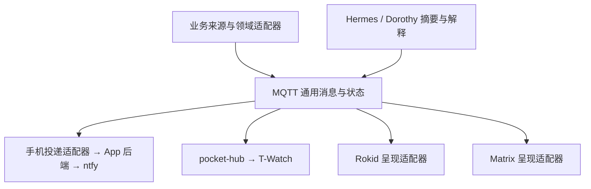

# 多来源、多设备消息设计

状态：2026-10-24 讨论稿。记录方向和扩展约束，各阶段是否上线以对应的实现和验收记录为准。

用户明确的架构边界：多个应用各自发布，多个设备或其适配器按需订阅；使用共同协议，不建设统一管理所有业务的消息服务。独立历史服务器、全局已读和集中偏好管理不属于当前规划。

第一阶段服务端已在 0.7.20 上线，App 0.1.39 已发布；协议与运行验收另见 [MQTT 业务消息 v1](message-events-v1.zh.md)。额外来源与多媒体呈现仍为规划。

## 目标

Agent、交易与市场观察、赛事、新闻和家居应用分别产出自己的消息。手机、Rokid、T-Watch 和 Matrix 独立选择需要的主题，按各自能力呈现文字、数值、图表、震动或语音。

MQTT 是共同的发布/订阅入口。来源维护业务事实和状态；消费者维护自身订阅、去重、免打扰和展示。App 后端是手机通道的适配器，手表和眼镜分别使用自己的适配器。Hermes/Dorothy 可以作为普通生产者或消费者参与，不承担必经的统一调度。

业务职责分散在来源与接收端；当前 MQTT broker 仍是共享的中心节点，拓扑并非设备点对点互联。既有消息中心一词只表达多端协作体验，不要求新增一个业务管理中心。

第一阶段仍按用户此前的决定，全量提醒 Agent 的完成、最终失败、待审批和待回答，不根据 SSE、在线状态或已读抑制投递。其他来源先定义事件，接入和提醒强度逐项落地。

## 已有能力与新增范围

- pocket-hub 已运行：接收 `pw/in/<source>/msg` 和 `state/<key>`，负责手表侧校验、去重、限流、中文渲染与显示仲裁。旧 AgentAdapter 通过 SSE 唤醒状态刷新，并产出 `pw/data/agent`。
- uctw-gateway 已有 HMAC 的 `/hooks/notify`、手机设备登记、RFC 8291 加密和 ntfy UnifiedPush 投递；App 已支持解密与打开对应 Agent 会话。第一阶段补齐了 `/hooks/events`、持久发件箱、业务去重、撤回和重试。接收端可按需提供当前待办或短期消息视图，无需先建设统一历史库。
- Bridge 0.7.17 的标准 ntfy JSON 发布器是未启用的预备实现，不是 App 的加密推送链路。
- Silas Grey、Polymaker、Dorothy 和 HA 是本次纳入设计的业务来源；本稿不宣称已检查或接入它们的全部当前实现。Rokid 的通知接收与下述呈现能力也是规划项。

## 数据、事件、消息和通知

1. **数据**：ETH 逐笔价格、每分钟温度、抓取的新闻素材。持续采样留在来源系统，按需引用，不把全部采样点送成通知。
2. **事件**：某个时间窗发生急跌、温度持续越线、盘口明显变化、新闻有实质进展。来源提供发生时间、指标、单位和证据。
3. **消息**：一件值得关注的事，具有稳定身份，可以合并、补充和解决。一轮持续的 ETH 急跌可对应一条持续更新的消息；相关报道可以归入同一新闻事件。
4. **通知**：某条消息在某个设备上的一次提醒。接收端可展示卡片而不立即打断用户，同一消息也可以在多个设备呈现。

业务状态由来源负责，投递接受、设备展示和用户打开由各通道或设备分别记录。设备打开一条通知不自动改变其他设备的已读状态。审批处理后，由 Agent 来源发布同一 key 的 resolved，各接收端据此移除待办提醒；无需统一已读中心。

## 来源与候选事件

| 来源 | 候选事件 | 结构化内容与消息生命周期 |
| --- | --- | --- |
| Agent Bridge | 完成、最终失败、待审批、待回答 | session/turn/request 身份，摘要、跳转；待办解决后撤回 |
| Silas Grey / 市场观察适配器 | ETH 短时急涨急跌、波动显著扩大、趋势变化；交易执行结果可另行接入 | 标的、观察窗口、起止价、幅度、成交量、发生时间、小段行情；同一次异动持续更新 |
| Polymaker | 关注比赛临近、盘口显著变化、已有投注结果或结算变化 | 对阵、时间、市场、盘口/概率变化、关联持仓与来源链接；按比赛和市场分组 |
| Dorothy / Hermes | 每三小时热点、日报、已有热点的新增进展 | 标题、摘要、来源、发表/抓取时间、主题关联；普通内容合成摘要，重要新增进展单列 |
| HA | 温度持续异常、设备离线、门铃、任务完成、异常恢复 | 实体、位置、测量值/单位、阈值、持续时间；异常到恢复使用同一事项身份 |

行情和温度的触发窗口、持续时间、冷却与恢复阈值由领域适配器定义。精确阈值实施时再定，避免同一阈值附近反复提醒。交易观察不依赖下单主循环；通知投递故障不能阻塞交易执行。

## 发布与订阅结构

下图包含规划中的接入端；通用 MQTT 消息当前已接通 Agent 到手机，手表与眼镜仍需各自适配。

各来源可直接发布到自己的授权主题，各设备通道独立消费。手机通过 App 网关和 ntfy 接收，是为适配 Android 后台投递与设备密钥；pocket-hub 和 Rokid 不经手机网关转发。现有 broker 与各通道适配器构成运行拓扑，不增加独立的消息历史或管理服务。

来源适配器或 Dorothy 产出符合消息契约的内容。以后确需跨来源摘要时，Hermes/Dorothy 等消费者可订阅相关主题，再用自己的来源身份发布派生消息；携带原始引用并避免循环。这是可选的普通来源，不成为所有消息的必经节点。

### 主题与兼容

- 通用主题已确定为 `uctw/messages/<source>/events` 和 `uctw/messages/<source>/state/<short-key>`，第一阶段来源为 `agent-bridge`；短 key 与载荷约束见 v1 契约。
- 一次性事件不 retain；状态主题保留最新状态，包括必要的 resolved 墓碑。墓碑到期后显式清理，不能无限积累。
- 手机、手表、眼镜或其通道适配器使用独立订阅身份，各自收到所需消息。不同设备通道不放入同一个共享订阅消费组。手机网关对已登记手机逐台投递。
- MQTT 账号与 topic ACL 限制来源和读取范围，来源身份以授权 topic 为准，不信任 payload 任意自报。
- 旧 `pw/in/*` 保持兼容。通用消息由 pocket-hub 转成手表协议，不把 `tpl`、字图和固件字段长度限制强加给其他来源与设备。
- Matrix 保留为一个独立渠道，迁移时逐来源关闭旧的重复发送路径。
- App 现有通知跳转仅接受 `/control/...`；行情、新闻等业务卡片需要另行增加受支持的路由和处理，不能假定现有会话跳转已覆盖任意消息。

## 可扩展的内容模型

候选字段分组如下，不要求第一阶段全部实现：

| 分组 | 内容 |
| --- | --- |
| 身份 | eventId、messageKey、revision、source、type、关联主题/原事件 |
| 时间与状态 | occurredAt、observedAt、expiresAt、active/resolved/message、级别 |
| 通用摘要 | title、短正文、来源与详情引用；每条消息均有文字摘要 |
| 事实数据 | 数值、单位、观察窗口、方向、差值、时间序列片段、比赛/设备等业务对象 |
| 媒体 | 图片、图表、可选语音等资源的引用、类型、尺寸与校验信息 |
| 导航与轻交互 | 查看详情/原始来源、稍后提醒、关注或静音同类消息、请求解释 |

同一业务消息更新时 key 不变、revision 增长；重试同一个事件时 eventId 不变。Agent 完成按 turn 区分，待办按 request 区分，不按整个 session 合成一条永久静默更新。

来源提供事实数据、模型推断与依据的区分。需要复盘的业务记录、研究结论或收藏由对应项目或笔记保存，消息携带引用；统一协议不要求把所有提醒长期归档。

图片、长音频和视频不塞进 MQTT 或手机推送载荷；使用可授权访问的资源引用和缓存。图表尽量由结构化数据生成，适配器按设备能力选择文字、数值、图标、小图或语音。媒体获取失败仍能展示通用摘要。

## 各端呈现目标

以下是设计目标，不代表目前各端均已支持。

| 渠道 | 合适的内容与交互 |
| --- | --- |
| App | 当前待办或短期卡片、数值/折线、图片、详情与来源；设备侧筛选和呈现，通知栏提供对应业务入口 |
| T-Watch | 数值、方向、简短标题、震动与粘性状态；按能力提供小图与跳转，保留现有免打扰和显示仲裁 |
| Rokid | 视野内的一两行 HUD、方向/图标、小型趋势图，可选短语音；展开或主动查询时才呈现更多信息 |
| Matrix | 可检索的文字摘要、来源和讨论上下文，继续供 Hermes/Dorothy 对话使用 |

例如“ETH 五分钟快速下跌”在 App 展示价格曲线、变化幅度与来源，手表展示方向/幅度并震动，眼镜提供简短 HUD。它们共享同一消息身份、事实和更新状态，呈现方式不同。

## 提醒策略与智能体分工

- Agent 的四类关键节点先全量提醒，保持此前决定。
- 保留手表现有权限：只有 HA 来源可发 critical，其他来源最高 alert；跨来源摘要不能绕过这条规则。
- 持续行情与家居状态使用变化触发、冷却和恢复更新；普通新闻可定时合并，重要进展可以即时提醒。
- 主题订阅、提醒级别、免打扰和展示偏好由各设备或其通道适配器维护。来源声明业务级别与有效期，接收端选择如何呈现。在线/已读抑制留到观察真实使用情况后再决定，不预设跨设备全局已读。
- 阈值告警与已有结构化事件走确定规则，不等待模型生成。Hermes/Dorothy 可做新闻编辑、跨来源关联、摘要、解释与按需查询。
- Hermes/Dorothy 既是消息生产者，也可以是消费者。例如用户询问“今天 ETH 的提醒发生了什么”，可查询来源项目的业务记录或自身消费记录后作答。
- 不要求每个项目接入大模型。Silas Grey 和 HA 可直接发布事实事件，之后再补充解释。

## 可靠性与生命周期

- 来源在 broker 不可达时持久化待发事件或使用已有可靠重试，重试保持 eventId。
- QoS 1 允许重复，也不代表业务已写盘。消费者在本地持久接收后确认；各通道独立去重与重试。需核对 broker 持久化、持久会话、队列上限和过期策略。
- App 网关继续 HTTP socket 激活、空闲退出。现由轻量常驻的 `uctw-relay` 订阅 MQTT 并转交本机网关，网关写盘后再确认 MQTT；网关负责手机发件箱和重试恢复。
- 统一使用绝对 expiresAt。网关、App、pocket-hub 校验过期，投递重试和 MQTT 延迟不能重置整个有效期；保留状态也需清理过期内容。
- 按 key 记录持久 revision 和 resolved 墓碑，终端也处理乱序，防止旧的 active 消息复活已解决待办。
- 幂等与墓碑初始保留期建议 7 天，并覆盖最大有效期与重试窗口。这些是短期可靠性记录。业务资料、媒体和必要的排错日志由各自所有者制定保留策略，长期通知档案不是运行前提。
- broker 当前在 HA 主机，HAL 到 broker 的连接成为手机推送路径依赖，验收需包含断线、重启和过期恢复场景。
- 所有退避/维护定时器按已有约定 unref；低频查询和渲染服务尽量按需启动。真正负责 MQTT 订阅的轻量进程承担常驻连接。

## 分阶段落地

1. **Agent 通知打通**：确定最小通用契约，Control Plane 发布 MQTT，手机可靠接收并支持待办更新/撤回。旧 `/hooks/notify` 的请求和同步 results 响应保持兼容；新增持久入口另用写盘后 202 契约。
2. **手表共用来源**：pocket-hub 适配通用消息、绝对过期与短身份映射，逐通道验收后关闭旧 AgentAdapter 的通知和 waiting state 输出，保留 `pw/data/agent` 状态页数据。
3. **更多独立来源**：逐项接 ETH 异动、Polymaker 赛事、Dorothy 摘要和 HA 异常；来源产出业务事实、变化和恢复，各接收端自行选择订阅。具体顺序按实际需求调整。
4. **丰富设备呈现**：图表/图片/可选语音、App 业务卡片、Rokid 适配；按真实投递量改进各端提醒规则。有明确需求时再增加可选的摘要来源。

第一阶段先保留身份、状态、来源、事实和媒体引用的扩展空间，避免在协议里写死“标题加正文”。具体交易信号、赛事数据接口、眼镜 SDK 和 UI 不属于本次实现。
